# Omics Canvas tutorial

Omics Canvas puts the lab's genomics data on one server page: **Genome Canvas** (genome browser), the **spatial
viewer**, the **single-cell viewer** and the **CRISPR explorer**. Each works in the browser and in a Mac app. This guide
shows every module with screenshots of public data (10x Genomics Visium human heart and PBMC 3k, CELLxGENE human arterial
atlas and mouse SMC time course, IGVF HCASMC CRISPR screens).

- [1. Getting started](#1-getting-started)
- [2. Genome Canvas](#2-genome-canvas)
- [3. Spatial viewer](#3-spatial-viewer)
- [4. Single-cell viewer](#4-single-cell-viewer)
- [5. CRISPR explorer](#5-crispr-explorer)
- [6. Adding and managing data](#6-adding-and-managing-data)
- [7. Mac apps](#7-mac-apps)
- [8. Tips](#8-tips)

## 1. Getting started

Open **http://171.65.68.140:8892** (THOR; from outside Stanford connect the VPN first). The home page links the four
modules and shows how many datasets your workspace has in each.

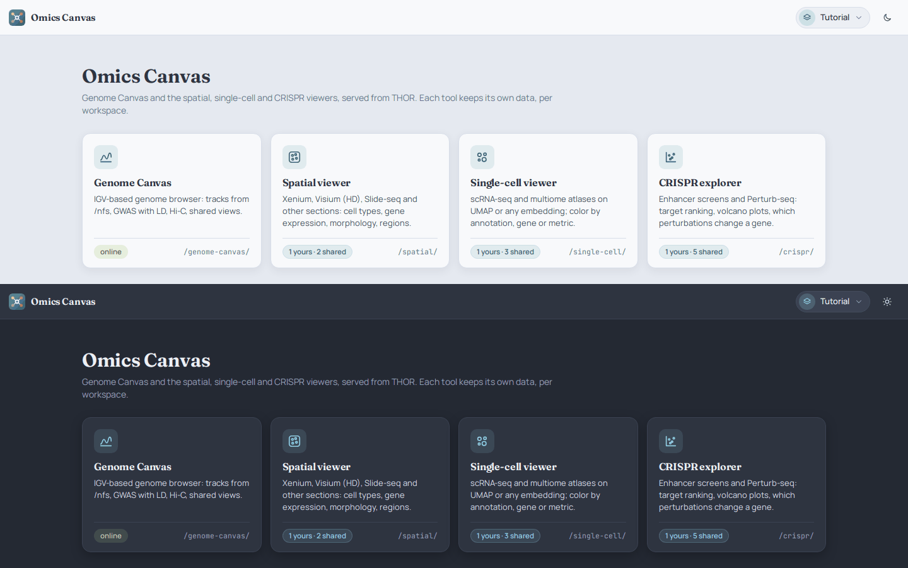

- **Workspace** (top right): your personal space, the same one you use in Genome Canvas (one per user; *Create* a new
  one in the chooser). Datasets you add belong to it: only you see, rename and remove them in your lists. A dataset's
  **link opens for anyone** you send it to.
- **Theme**: light / dark follows your system; the moon / sun button switches it, for all four modules.
- The small **Omics Canvas** button at the top left of every module returns to the home page.

## 2. Genome Canvas

`/genome-canvas/` — an IGV.js genome browser with the lab's server files.

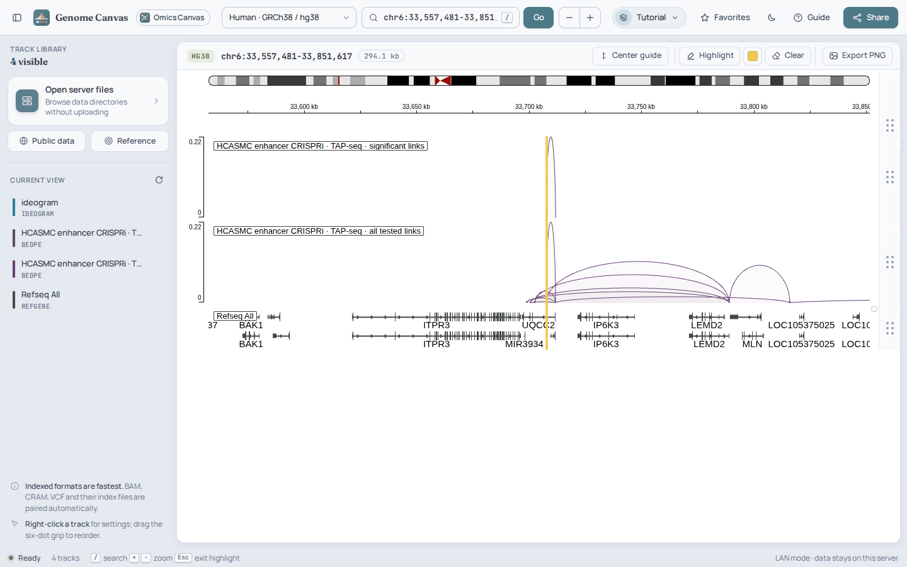

- **Find a place**: type a gene, rsID or region in the locus box (`/` or ⌘K jumps there); change the genome (hg38,
  hg19, mm39, mm10, rn7, danRer11, dm6, sacCer3, or **Reference** for your own FASTA / 2bit).
- **Add tracks**: **Open server files** browses `/nfs` without uploading (BAM, CRAM, VCF, BigWig, BigBed, BED, BEDPE
  loops, Hi-C, GWAS / QTL summary statistics with LD, GTF, SEG, MAF …; index files are found automatically).
  **Shared tracks** lists every server file anyone in the lab has loaded (name, folder, format, genome, who loaded
  it): filter, tick and **Load selected tracks**, with no path to look for. Files in Home folders are not listed;
  deleted or moved files drop off the list by themselves, rewritten ones show their new date, and **×** on a file you
  shared first takes it off the list.
  **Public data** searches ENCODE, GTEx, Roadmap and 4DN hubs or takes a UCSC / WashU hub URL or any track URL.
- **Arrange**: drag the six-dot grip to reorder tracks; right-click a track for color, height, data range and display
  mode; remove it in the track list on the left. Assay colors are automatic and stay the same in both themes.
- **Mark**: **Highlight** then drag over the tracks to shade a region (pick the color next to it; **Clear** removes
  all); **Center guide** draws a line at the center.
- **Keep and share**: **Favorites** saves the whole view (tracks, locus, highlights) as a named profile in your
  workspace; **Share** copies a link that restores the view; **Export PNG** saves the canvas with a transparent
  background.
- **Links from other modules** open a region with highlights and tracks, e.g.
  `/genome-canvas/?locus=chr6:33,557,481-33,857,780&highlight=chr6:33,707,481-33,707,780` (the CRISPR explorer adds
  the screen's loops this way).

## 3. Spatial viewer

`/spatial/` — tissue sections: Xenium, Visium / Visium HD, Slide-seq, spatial ATAC and other data with cell or spot
coordinates. Without a dataset in the address the page lists your datasets ([section 6](#6-adding-and-managing-data)).

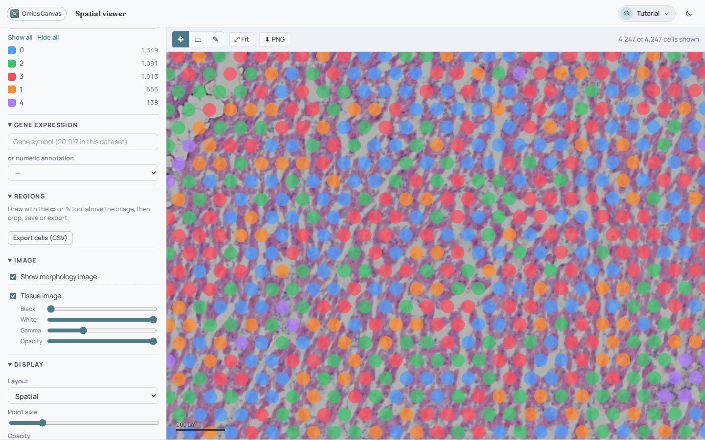

- **Dataset / sample**: the menu at the top left switches datasets and the samples of a multi-sample dataset
  (sections, time points); the address (`?s=sample`) keeps the choice, so you can share it.
- **Navigate**: scroll to zoom, drag to pan, **Fit** to see everything; the scale bar shows µm when the data has a
  known pixel size.
- **Cell annotation**: pick a column (cell type, cluster, …); click a category to show or hide it, its swatch to change
  its color, *Show all* / *Hide all*.
- **Gene expression**: type a gene (or pick a numeric annotation such as counts). Choose log-normalized or raw values,
  a colormap, the min / max range (histogram above), and whether cells at or below the minimum are gray, hidden or
  colored. With several assays (e.g. RNA, peaks, gene activity, chromVAR) choose it in **Assay**.
- **Image**: the tissue image is drawn under the cells — H&E or IHC in its own colors with an **Opacity** slider,
  fluorescence channels (Xenium morphology) each with its color; **Black / White / Gamma** adjust the contrast.
- **Regions**: draw a box (▭) or a free shape (✎) on the tissue to select cells. The panel then shows their composition;
  **Crop to selection** (and **Invert**) shows only them, **Save…** keeps the region in this browser,
  **Export cells (CSV)** downloads the cells (all or the selection) with their annotations.
- **Display**: layout (spatial or an embedding such as UMAP), cells as points or segmentation polygons, point size,
  opacity, and the background (theme color or your own). **⬇ PNG** exports the view with a transparent background.

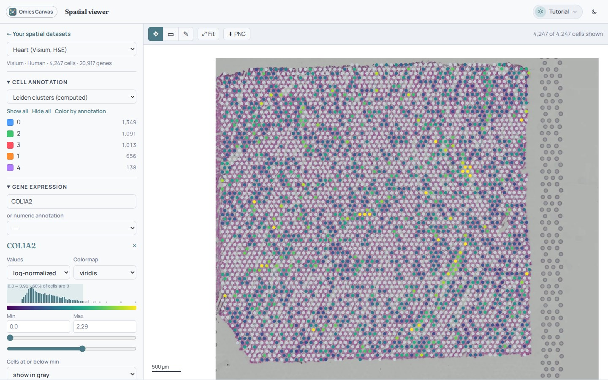

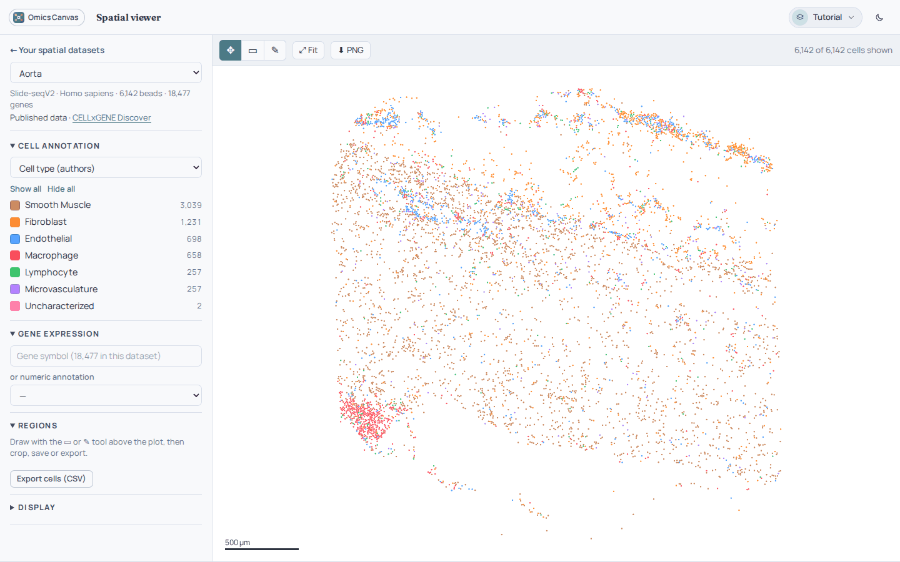

Spatial ATAC data has the same accessibility panel as the single-cell viewer below.

## 4. Single-cell viewer

`/single-cell/` — scRNA-seq, snRNA-seq, multiome and scATAC on UMAP or any embedding. The controls are those of the
spatial viewer (annotation, gene, regions, display, PNG); the layout menu switches embeddings.

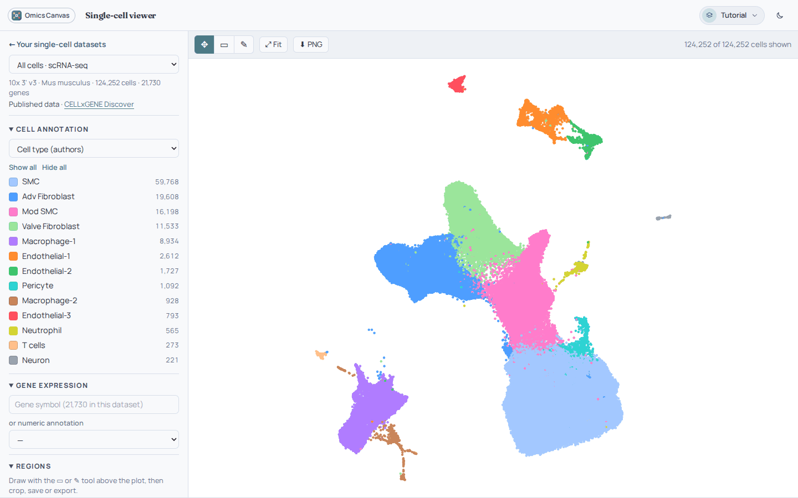

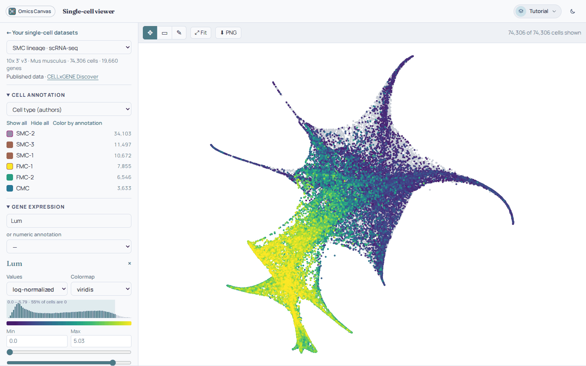

- **Samples**: a dataset can hold several samples (here scRNA-seq of the SMC lineage, of all cells, and scATAC-seq).
- **Multiome / scATAC**: choose the **Assay** — RNA, peaks, gene activity, chromVAR (diverging colors around 0; the
  motif's sequence logo is shown).
- **Chromatin accessibility** panel (with any assay that has genomic positions): coverage of each cell group around
  the gene you type, the dataset's peaks and gene models. ◀ ▶ move, ＋ － zoom, *Same scale* compares groups, the peak
  threshold filters peaks; drag over the tracks to mark a region and **Color cells by this region**.

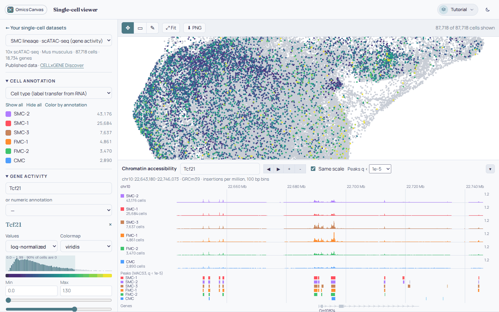

## 5. CRISPR explorer

`/crispr/` — enhancer screens (e.g. TAP-seq) and Perturb-seq, from SCEPTRE, IGVF or any target / gene / log2FC /
p-value table. The menu at the top switches screens (combined screens are listed under their name).

**Enhancer screens** — every enhancer–gene test:

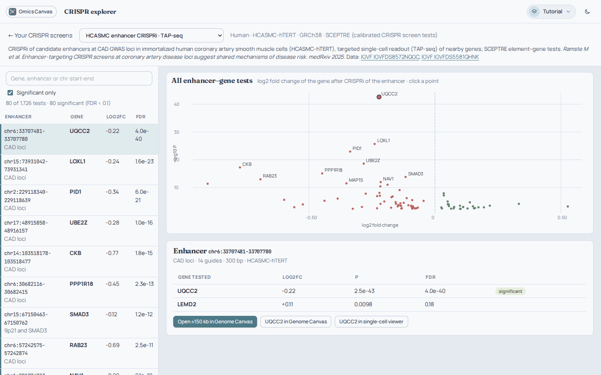

- Search a gene, an enhancer or `chr:start-end`; **Significant only** keeps tests at FDR < 0.1.
- Click a point or a row: the enhancer's tested genes with log2FC, P and FDR.
- **Open ±150 kb in Genome Canvas** shows the region with the enhancer highlighted and two loop tracks — the screen's
  significant and all tested enhancer → gene links (arc height = |log2FC|); the gene buttons open the gene in Genome
  Canvas (with the loops) or in the single-cell viewer.

**Perturb-seq** — targets ranked by the number of genes they change, and one target's effect on every readout gene:

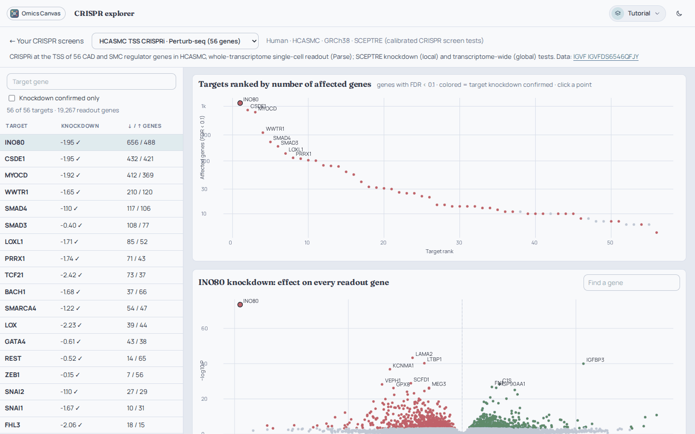

- Click a target (plot or table); **Knockdown confirmed only** keeps targets whose own expression dropped.
- **Find a gene** shows which perturbations change that gene; **Download all … results (CSV)** saves a target's table.

## 6. Adding and managing data

Each viewer's page without a dataset (`/spatial/`, `/single-cell/`, `/crispr/`) manages its datasets.

**Shared in the lab** — every dataset anyone has loaded, converted or combined in this viewer, with who shared it and
its source. **Add to mine** puts it in your list at once (nothing is copied or converted again; **Open** looks at it
first). The list follows the files: a dataset whose converted files were deleted disappears, one that was converted
again or renamed by the person who added it is updated, and a conversion whose source file changed since is marked
*source changed* (select the source under **Add data** to convert it again). **Unshare** takes your own dataset off the
list. The home page counts shared datasets on each card.

**Add data** — browse `/nfs` (or paste a path) and select a file or folder; the right side says what it is and how
it will be read.

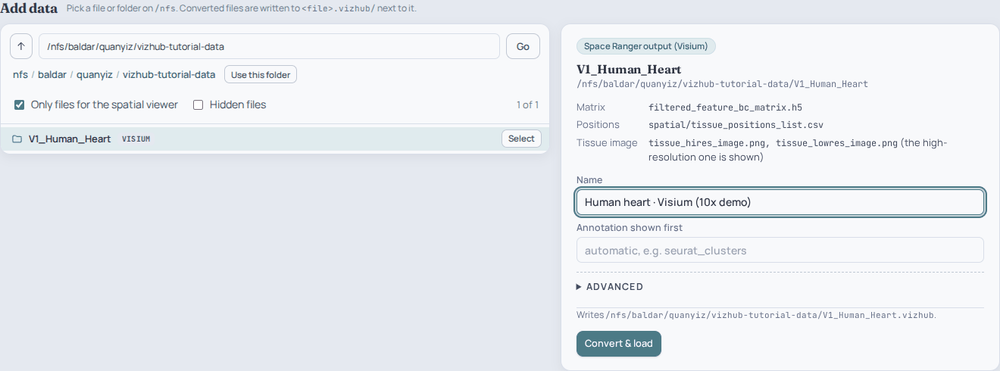

| Viewer | Reads |
| --- | --- |
| Spatial | `.h5ad` with `obsm["spatial"]` (H&E from `uns["spatial"]`); Seurat / SpatialExperiment `.rds` (Visium, Visium HD, Xenium / FOV, spatial ATAC) with their images; Space Ranger folders (`spatial/` + matrix); Xenium output folders (morphology, cell outlines, post-Xenium H&E with its Xenium Explorer alignment) |
| Single-cell | `.h5ad`; Seurat / Signac / SingleCellExperiment `.rds` (every assay, chromVAR motifs, fragment files → accessibility tracks); `.h5mu` MuData; 10x `.h5`; `.loom` |
| CRISPR | SCEPTRE / IGVF / generic result tables (`.tsv`, `.csv`, `.parquet`) or an `.rds` sceptre_object / data.frame |
| All | folders already in the viewer format (`slide.json`, `project.json`) are loaded as they are |

- **Convert & load** writes the viewer files to `<source>.vizhub/` next to the source (sources are never changed).
  **Advanced** sets the matrix, assay, µm per pixel, spot size, a computed UMAP (with Leiden clusters), the GTF and
  whether to read fragment files.
- **Conversions** run on THOR — close the page or your laptop, they continue. At most 8 run at once (the rest wait in
  line); after a restart they resume from their last finished step, and long ones (large fragment files) say how long
  to expect. **Show log** shows the converter's output.

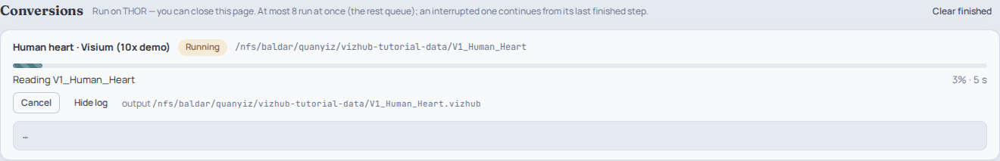

**Combine datasets** — put samples of several datasets (sections, time points, conditions; CRISPR: screens) into one
dataset with one link and a sample picker. Order and rename the samples; nothing is copied.

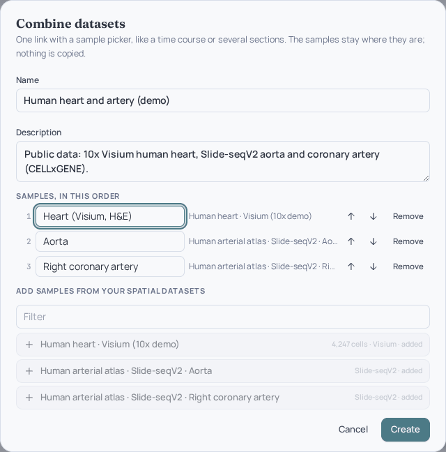

The list shows combined datasets and multi-sample projects as groups: the arrow opens their samples, and the datasets
that went into a combined one are listed there (with their own **Rename** / **Remove**).

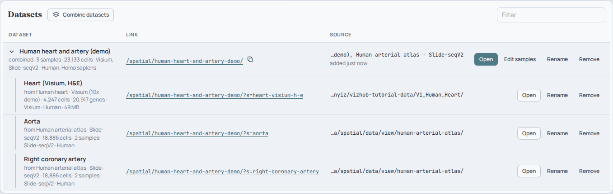

- **Edit samples** changes a combined dataset later — and the samples of existing projects (e.g. drop or rename a
  section); a project folder itself is not changed, **Restore the folder's samples** undoes it.
- **Rename** changes the name (not the link). **Remove** takes a dataset out of your workspace; for converted data
  you may also delete the `.vizhub` folder (kept while a combined dataset or another workspace uses it). Source data is
  never deleted.

## 7. Mac apps

Download from the [latest release](https://github.com/QuertermousLab/omics-canvas/releases/latest) — Apple Silicon
(`…-macOS-arm64.zip`) or Intel (`…-macOS-x86_64.zip`), unzip, move to Applications and run once in Terminal
(the apps are not notarized):

```bash
xattr -dr com.apple.quarantine "/Applications/Omics Canvas.app" "/Applications/Genome Canvas.app"
```

**Genome Canvas.app** — the genome browser in a native window: the same canvas with a native track list, genome and
locus fields, highlight tools and workspace menu. **Server** uses THOR's files; **This Mac** starts a built-in backend
for files on your Mac (**Open local files**). Shortcuts: ⌘O server files, ⌘D public data, ⇧⌘S favorites, ⇧⌘E PNG,
⇧⌘T light / dark, ⌘, server address.

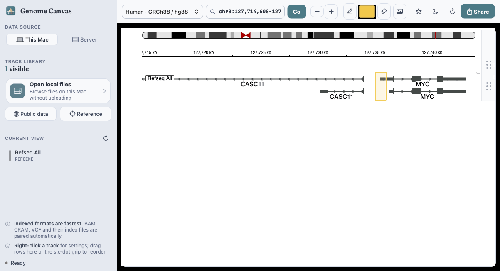

**Omics Canvas.app** — the spatial, single-cell and CRISPR viewers in one window. The sidebar picks the viewer
(⌘1 / ⌘2 / ⌘3), your workspace and your datasets: groups (combined datasets, projects) open with the arrow, a sample
opens with a click. Right-click a dataset for **Open**, **Edit Samples…**, **Rename…**, **Remove…**,
**Combine Datasets…**; the stack button above the list combines too.

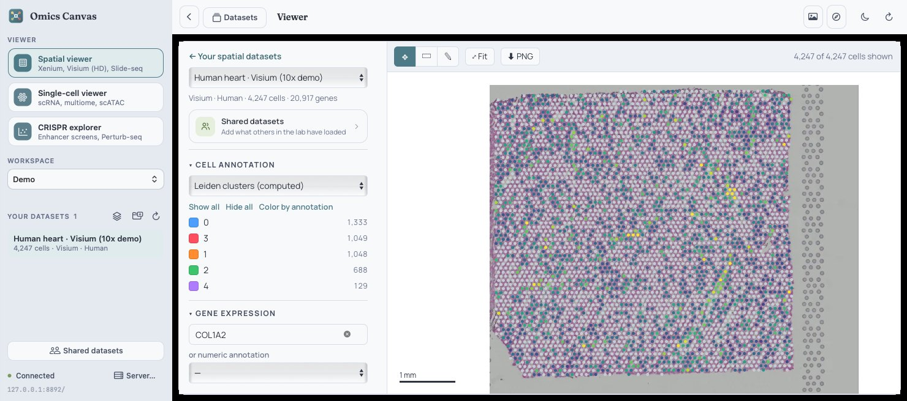

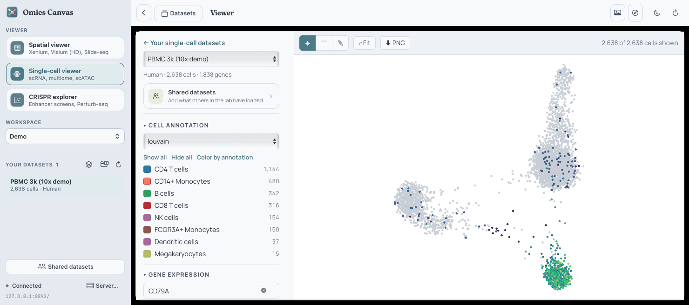

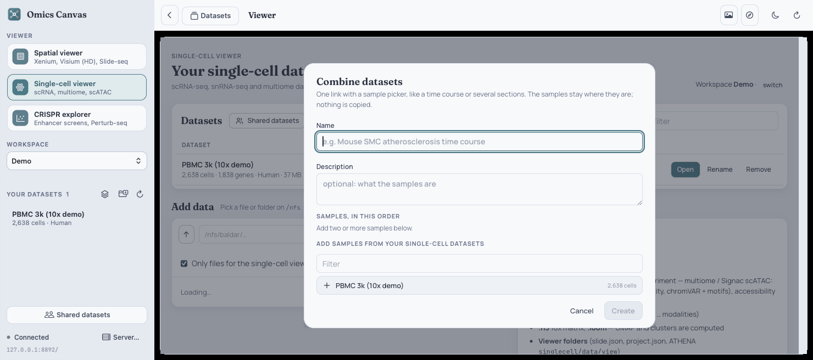

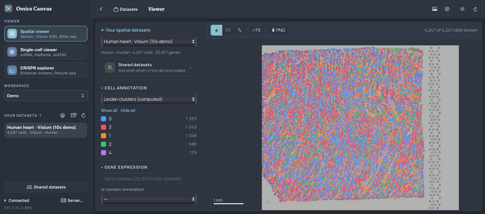

- Toolbar: back, **Datasets** (add, convert, manage — ⌘O), Export PNG (⇧⌘E), open the page in your browser (⇧⌘B),
  light / dark (⇧⌘T), reload (⌘R). **Server…** (⌘,) connects to another address.
- Genome Canvas links (from the CRISPR explorer) open in **Genome Canvas.app** when it is installed — in place if it
  is already open, keeping its tracks — otherwise in your browser.

## 8. Tips

- **Share** any view by copying the address: dataset, sample (`?s=`), gene (`?gene=`) and CRISPR selection are in it.
- **Figures**: every PNG export has a transparent background; set the plot background under *Display* to preview it.
- **No login**: anyone who can reach port 8892 can open dataset links; workspaces keep lists tidy, they are not
  access control. Do not add data that must stay private.
- **Large data**: 50–100 GB fragment files take hours; the conversion card shows an estimate. Uncheck the fragment files
  under *Advanced* for a quick first look.
- **Problems**: a conversion card's **Show log** has the converter's message; the dataset page of each viewer lists
  what it reads. The project's [README](../README.md) covers the server and command-line conversion.
