# Omics Canvas tutorial

Omics Canvas puts the lab's genomics data on one server page: **Genome Canvas** (genome browser, with **GREAT**
region set enrichment), the **spatial viewer**, the **single-cell viewer** and the **CRISPR explorer**. Each works in the browser and in a Mac app. This guide
shows every module with screenshots of public data (10x Genomics Visium human heart and PBMC 3k, CELLxGENE human arterial
atlas and mouse SMC time course, IGVF HCASMC CRISPR screens, UCSC hg38 annotation tracks, ENCODE MYB ChIP-seq peaks).

- [1. Getting started](#1-getting-started)
- [2. Genome Canvas](#2-genome-canvas)
- [3. Spatial viewer](#3-spatial-viewer)
- [4. Single-cell viewer](#4-single-cell-viewer)
- [5. CRISPR explorer](#5-crispr-explorer)
- [6. Shared data](#6-shared-data)
- [7. Adding and managing data](#7-adding-and-managing-data)
- [8. Mac apps](#8-mac-apps)
- [9. Tips](#9-tips)

## 1. Getting started

Open **http://171.65.68.140:8892** (THOR). From outside Stanford, connect to the Stanford VPN first.

**Sign in** first — any page sends you to the sign-in page and back to that page afterwards:

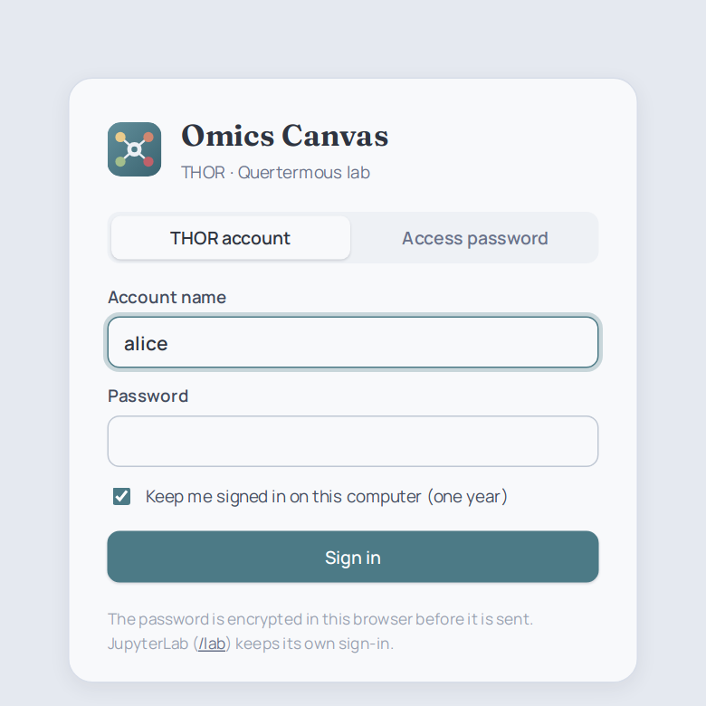

- **THOR account**: your THOR account name and password (the same as for SSH).
- **Access password**: for people without a THOR account; the administrator gives it out, and it works until its
  expiry date.
- **Keep me signed in on this computer** keeps you signed in for a year in this browser (counted from your last
  visit); without it you are signed out when the browser closes. **Sign out** is in the top bar of every page.
- Five wrong passwords in a row lock the account and the computer out for 15 minutes. JupyterLab (`/lab`) keeps its
  own sign-in, and GREAT's programming interfaces (rGREAT, `greatStart.php`) work without signing in.
- **Admin** (administrators, `/admin/`): access passwords (add one with a name and an expiry date — it is shown once;
  disable, extend or delete it later, which signs out everyone who used it), everyone signed in (sign a session out),
  the sign-in settings and log, and GREAT's settings.

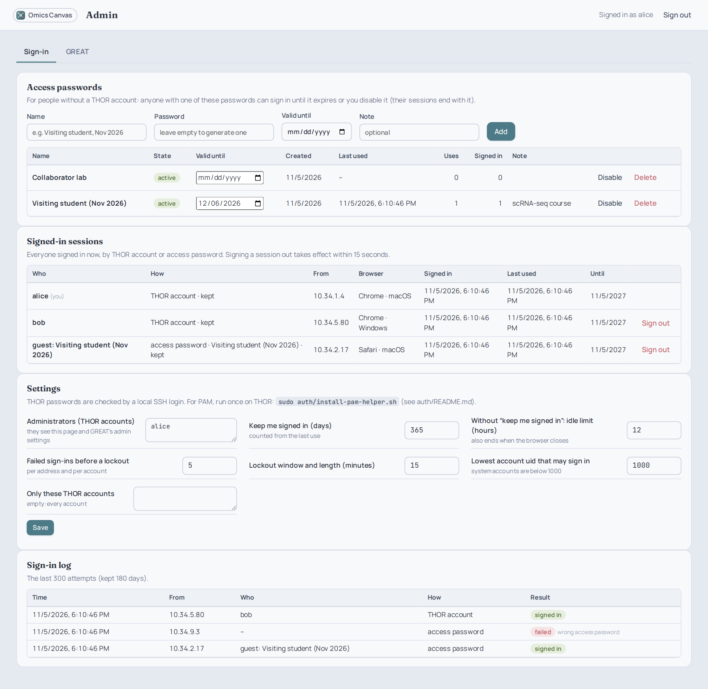

The home page (`/`; every module has its own address below it: `/genome-canvas/`, `/great/`, `/spatial/`,
`/single-cell/`, `/crispr/`) groups the modules — *Genome and regions* (Genome Canvas, GREAT) and *Single-cell, spatial
and CRISPR screens* — and shows whether each service is online and how many datasets your workspace has in each (*yours*) and how many
the lab shares ([section 6](#6-shared-data)).

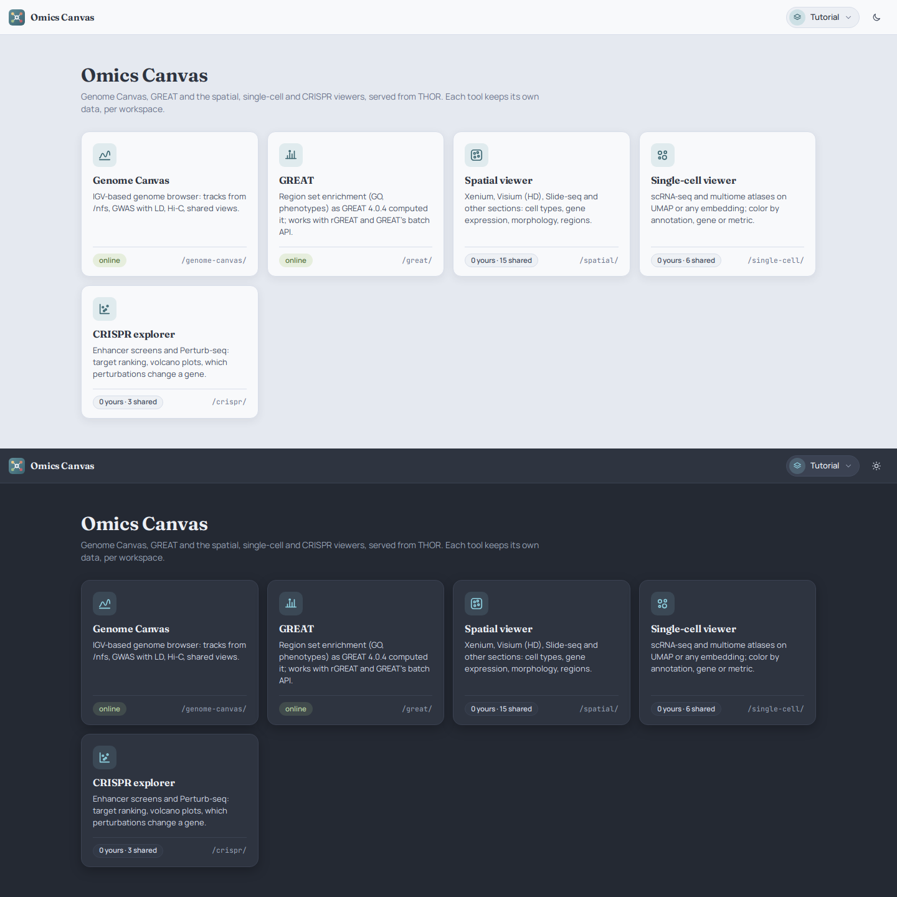

- **Workspace** (top right): your personal space, the same one you use in Genome Canvas (one per user; *Create* a new
  one in the chooser). Datasets you add belong to it: only you see, rename and remove them in your lists. A dataset's
  **link opens for anyone** you send it to.
- **Theme**: light / dark follows your system; the moon / sun button switches it, for all four modules.
- The small **Omics Canvas** button at the top left of every module returns to the home page.

## 2. Genome Canvas

`/genome-canvas/` — an IGV.js genome browser with the lab's server files.

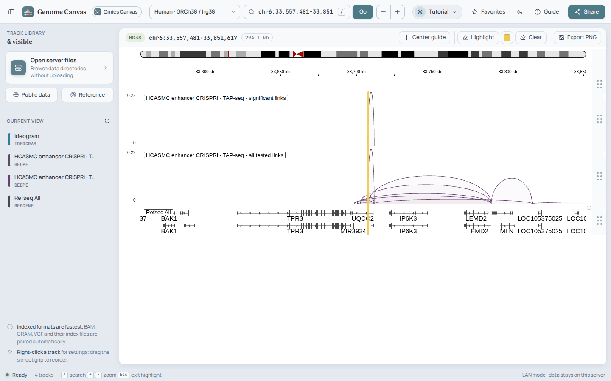

- **Find a place**: type a gene, rsID or region in the locus box (`/` or ⌘K jumps there); change the genome (hg38,
  hg19, mm39, mm10, rn7, danRer11, dm6, sacCer3, or **Reference** for your own FASTA / 2bit).
- **Add tracks**: **Open server files** browses `/nfs` without uploading (BAM, CRAM, VCF, BigWig, BigBed, BED, BEDPE
  loops, Hi-C, GWAS / QTL summary statistics with LD, GTF, SEG, MAF …; index files are found automatically).
  **Shared tracks** lists every server file anyone in the lab has loaded — tick and load them without looking for
  their paths ([section 6](#6-shared-data)).
  **Public data** searches ENCODE, GTEx, Roadmap and 4DN hubs or takes a UCSC / WashU hub URL or any track URL.
- **Genome builds**: a file that says it is on another build than the view (chromosome sizes in its header, or
  *hg19* / *GRCh37* … in its name) asks before loading: **Convert to hg38** writes a converted copy to the Genome
  Canvas data folder (never next to the original) and loads it; **Load it as it is** or **Skip this file**.
  **Liftover** (under the source buttons) converts pasted regions or the current view between hg19 ↔ hg38 and
  mm10 ↔ mm39 (click a result to go there, or copy them as BED), and track files in the view (BED, narrowPeak,
  bedGraph, bigWig, BAM, GTF/GFF, VCF, BEDPE).
- **LocusCompare**: compare a GWAS track with GTEx eQTLs, as [locuscompare.com](http://locuscompare.com) does.
  - Open it from a GWAS track's menu (right-click the track → **LocusCompare with GTEx eQTLs…**), from a SNP's popup
    (**Compare with GTEx eQTLs ›**, with that SNP as the lead) or with **LocusCompare** next to **Liftover** (in the Mac
    app: the same button, or **File → LocusCompare…**, ⌥⌘C).
  - The figure plots each variant's GWAS −log₁₀ P against its eQTL −log₁₀ P, with a LocusZoom panel for each study
    and the genes below. Points are colored by r² with the lead SNP (purple diamond), as in the GWAS tracks.
  - Pick the **eQTL source and tissue**: *GTEx v8 · all pairs* (every tested variant–gene pair; all 49 tissues on
    THOR), *GTEx v10 · all pairs* (every tested pair with more donors, e.g. 268 instead of 213 for Artery - Coronary,
    so eQTL p-values are often smaller; the three arteries so far) or *GTEx v11 · significant pairs* (only the pairs
    below each gene's threshold, so the plot has fewer points). Then the **gene** (*Best match* is the eGene whose
    eQTLs best overlap the GWAS signal), the **LD** population (1000 Genomes EUR, AFR, AMR, EAS, SAS, ALL, or the
    study's own LD) and the region (up to 3 Mb).
  - The lead SNP is the one with the smallest sum of the two p-values. **Click a point** to make it the lead.
  - GWAS files with groups (e.g. one per ancestry) show one group at a time. A file that lists only the variants in
    high LD with its signals shows few points; use **The study's own LD** for it.
  - **SVG**, **PNG** and **Table** (both p-values, betas and r² of every shared variant) download the figure and
    its data; **Show lead** goes to the lead SNP in the browser.
  - On a new server, `genome-canvas/tools/fetch_external_data.py --configure` downloads the public data this uses
    (GTEx, 1000 Genomes, GENCODE genes, the Aragam 2022 CAD GWAS, liftover chains) and adds it to the configuration
    (see [External data](../genome-canvas/README.md#external-data)).
- **Arrange**: drag the six-dot grip to reorder tracks; right-click a track for color, height, data range and display
  mode; remove it in the track list on the left. Assay colors are automatic and stay the same in both themes.
- **Mark**: **Highlight** then drag over the tracks to shade a region (pick the color next to it; **Clear** removes
  all); **Center guide** draws a line at the center.
- **Keep and share**: **Favorites** saves the whole view (tracks, locus, highlights) as a named profile in your
  workspace; **Share** on a Favorite lists it for the lab (others **Load** it or **Save a copy**; only you change it);
  **Share** in the top bar copies a link that restores the view; **Export PNG** saves the canvas with a transparent
  background. Exported figures (here and in the other viewers) are set in Arial.
- **Links from other modules** open a region with highlights and tracks, e.g.
  `/genome-canvas/?locus=chr6:33,557,481-33,857,780&highlight=chr6:33,707,481-33,707,780` (the CRISPR explorer adds
  the screen's loops this way).

### GREAT: what a region set is near

`/great/` — GREAT (Genomic Regions Enrichment of Annotations Tool, McLean et al. 2010) as its original
server computed it; great.stanford.edu is offline. It assigns each region to the genes whose regulatory domains hold
it and tests GO terms, mouse and human phenotypes and single genes.

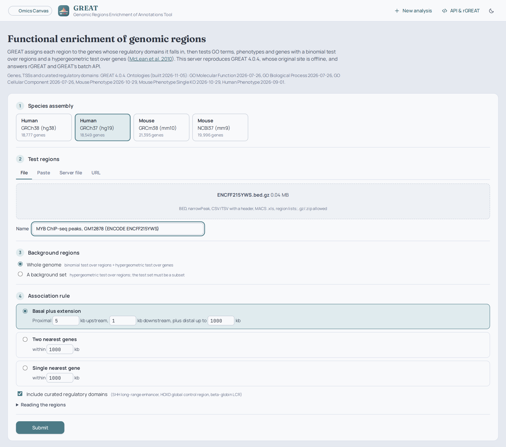

- **Open it** from a region track's menu in Genome Canvas (right-click a BED / narrowPeak track → **GREAT enrichment
  of these regions…**, which brings that track as the test set), with the **GREAT** button under the source buttons
  (in the Mac app: the same button or **File → GREAT Enrichment…**, ⌥⌘G, which open it in your browser), or from the
  Omics Canvas home page.
- **Regions**: upload a file, paste regions, pick a server file or give a public URL. Any BED flavor, narrowPeak,
  CSV/TSV tables whose header names the chromosome, start and end columns (e.g. a `GRanges` exported from R), MACS
  `.xls` and `chr1:1,000-2,000` lists are read; `.gz` and `.zip` too. Chromosome names such as `1` or `MT` are
  understood. Contigs outside the assembly and broken lines are skipped and listed under **How the input was read**.
- **Background**: the whole genome (GREAT's binomial test over regions plus a hypergeometric test over genes), or
  your own background set (a hypergeometric test over regions; e.g. all peaks of a factor, testing those without its
  motif).
- **Association rule**: GREAT's defaults (basal 5 kb upstream and 1 kb downstream, extended up to 1 Mb; curated
  domains for SHH, the HOXD cluster and β-globin) or two nearest / single nearest gene. **Reading the regions** sets
  0- or 1-based coordinates and whether peaks are placed at their summit.

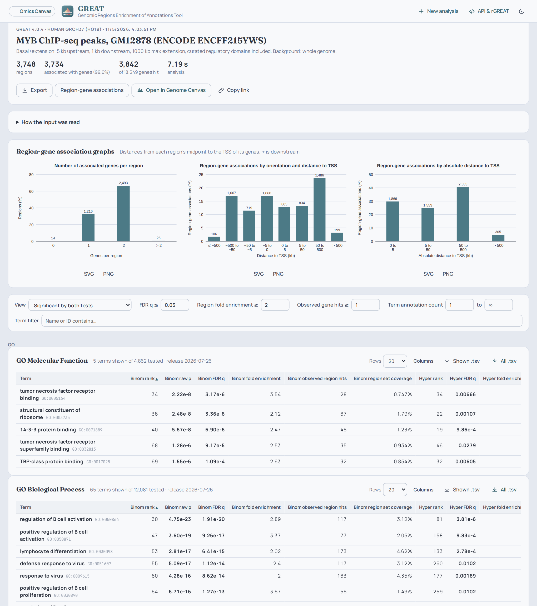

- **Results** open after a few seconds: the three region-gene association graphs and one table per ontology.
  The default view, as in GREAT, shows terms significant by both tests (FDR ≤ 0.05) with a region fold enrichment of
  at least 2; switch to the binomial test only or all terms, change the thresholds, the term annotation count range or
  search terms. Click a column to sort; **Columns** adds hidden ones (Bonferroni p, expected hits, genome fraction …).
  Bold p-values pass the threshold; bold terms pass both tests.
- **Click a term** for its regions and genes: graphs against all regions, region → genes and gene → regions tables,
  links that open a region or a gene's regulatory domain in Genome Canvas with the term's regions as a track, and
  downloads.

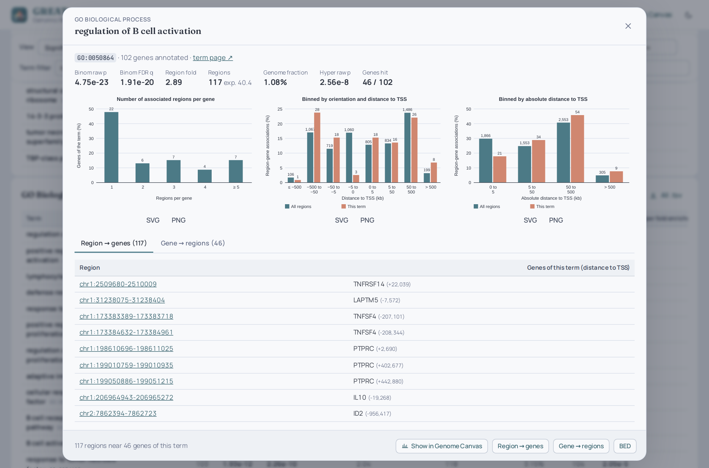

- **Export**: all data as GREAT's `.tsv`, the shown tables as `.tsv` or HTML, the region-gene associations, the regions
  as BED; each graph as SVG or PNG (Arial). **Copy link** shares the results (kept 30 days).
- **From R**: rGREAT's online functions work against this server:

  ```r
  library(rGREAT)
  source("http://171.65.68.140:8892/great/rgreat.R")
  job <- submitGreatJob(gr, genome = "hg38", request_interval = 0)
  getEnrichmentTables(job); getRegionGeneAssociations(job); plotRegionGeneAssociations(job)
  ```

  Scripts can use GREAT's batch interface, e.g. `curl -F outputType=batch -F requestSpecies=hg38 -F
  requestFile=@peaks.bed.gz http://171.65.68.140:8892/great/public/cgi-bin/greatStart.php`; the
  **API & rGREAT** section at the bottom of the page lists these with the server's current limits.
- **Admin**: administrators open the admin page's **GREAT** tab (`/admin/#great`, or **Admin** in GREAT's top bar):
  request limits — the minimum interval between analyses per client, analyses per hour and at once, how long requests
  wait in the queue, region and file size limits, how long results are kept and how much space they may take — change
  at once, without a restart. **Stored analyses** lists everyone's results with their size and age: delete the
  selected ones, those older than a number of days, or all; **Apply retention and storage limit now** runs the
  automatic cleanup, which otherwise runs every 10 minutes. It also shows running and waiting analyses.

## 3. Spatial viewer

`/spatial/` — tissue sections: Xenium, Visium / Visium HD, Slide-seq, spatial ATAC and other data with cell or spot
coordinates. Without a dataset in the address the page lists your datasets ([section 7](#7-adding-and-managing-data)).

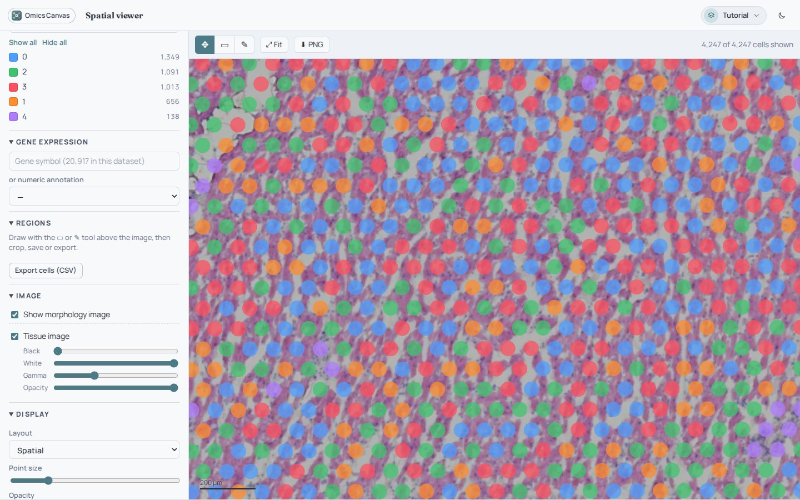

- **Dataset / sample**: the menu at the top left switches datasets and the samples of a multi-sample dataset
  (sections, time points); the address (`?s=sample`) keeps the choice, so you can share it.
- **Navigate**: scroll to zoom, drag to pan, **Fit** to see everything; the scale bar shows µm when the data has a
  known pixel size.
- **Cell annotation**: pick a column (cell type, cluster, …); click a category to show or hide it (Alt-click: only
  it), its swatch to change its color, *Show all* / *Hide all*. Shown / hidden belongs to that column; to keep a subset
  while you look at another column, click **Keep only these cells** — e.g. show only *donor1* under *individual*,
  keep, then color by *cell type*: only donor1's cells are drawn and counted. Filters appear as chips
  (*Only individual: donor1 ×*), combine with each other, apply to gene coloring, regions and CSV export, and are kept
  in the page address. On a UMAP or other embedding, **Labels on the plot** writes each shown category's name at the
  center of its cells (the slider sets their size; they are also in PNG exports, and the choice is remembered).
- **Gene expression**: type a gene (or pick a numeric annotation such as counts). Choose log-normalized or raw values,
  a colormap, the min / max range (histogram above), and whether cells at or below the minimum are gray, hidden or
  colored. With several assays (e.g. RNA, peaks, gene activity, chromVAR) choose it in **Assay**.
- **Module score**: paste a gene list (spaces, commas, semicolons or new lines; quotes and brackets are ignored) and
  **Score cells**. Names are matched ignoring case (MYH11 → Myh11 in mouse data); the note lists what was matched by
  another spelling and what is not in the dataset. **AUC (AUCell)** scores where the genes rank among each cell's top
  5% of genes (0–1, comparable across samples); **Seurat AddModuleScore** is the mean expression minus control genes
  of similar expression, as in Seurat. The first score of a dataset ranks every cell's genes once (seconds to two
  minutes); later ones take about a second. **Save** keeps a score under a label: it is listed under the box and with
  the numeric annotations, opens without computing for everyone who has the dataset, and only you can delete it.
  Saved scores are small files kept by the hub, not written into the dataset.
- **Export & plots**: the expression of some genes in some cells, as a file or a plot.
  - **Genes**: paste them as for a module score. Leave the box empty for every gene (best as Matrix Market).
  - **Cells**: *All cells*, *Cells shown* (what the legend and filters keep), the *Selected region*, or *By annotation*
    (tick clusters or other categories of a column).
  - **Values**: *Normalized*, log1p(counts / total × 10,000) as the viewer shows them, or raw *Counts*. Counts are not
    available when the data has no counts (values stored as given).
  - **Annotation column**: adds a column such as the cell type next to each cell.
  - **Export matrix** writes CSV, TSV or gzip-compressed CSV, with cells or genes as rows, or a 10x-style Matrix Market
    folder (zip of `matrix.mtx`, `features.tsv`, `barcodes.tsv`, `metadata.tsv`) that Seurat's `ReadMtx` and scanpy's
    `read_10x_mtx` open.
  - **Copy API call** copies the same request as a `curl` command (see [Tips](#9-tips)).
  - **Plot** draws one gene, one module score (saved, or the one just computed) or one numeric annotation in the
    chosen cells, as a **Violin** plot (as Seurat's `VlnPlot`) or a **Ridge** plot (as `RidgePlot`), grouped by an
    annotation, with the groups' colors.
    - **Points** shows up to 400 cells per group.
    - **Above 0 only** leaves out cells with no expression.
    - Hover a group for its cells, % above 0, median and mean.
    - The plot window saves **SVG**, **PNG** or the per-group numbers (**Table**).
    - One plot is computed at a time.
- **Image**: the tissue image is drawn under the cells — H&E or IHC in its own colors with an **Opacity** slider,
  fluorescence channels (Xenium morphology) each with its color; **Black / White / Gamma** adjust the contrast.
- **Regions**: draw a box (▭) or a free shape (✎) on the tissue to select cells. The panel then shows their composition;
  **Crop to selection** (and **Invert**) shows only them, **Save…** keeps the region in this browser,
  **Export cells (CSV)** downloads the cells (all or the selection) with their annotations.
- **Display**: layout (spatial or an embedding such as UMAP), cells as points or segmentation polygons, point size,
  opacity, and the background (theme color or your own). **⬇ PNG** exports the view with a transparent background.

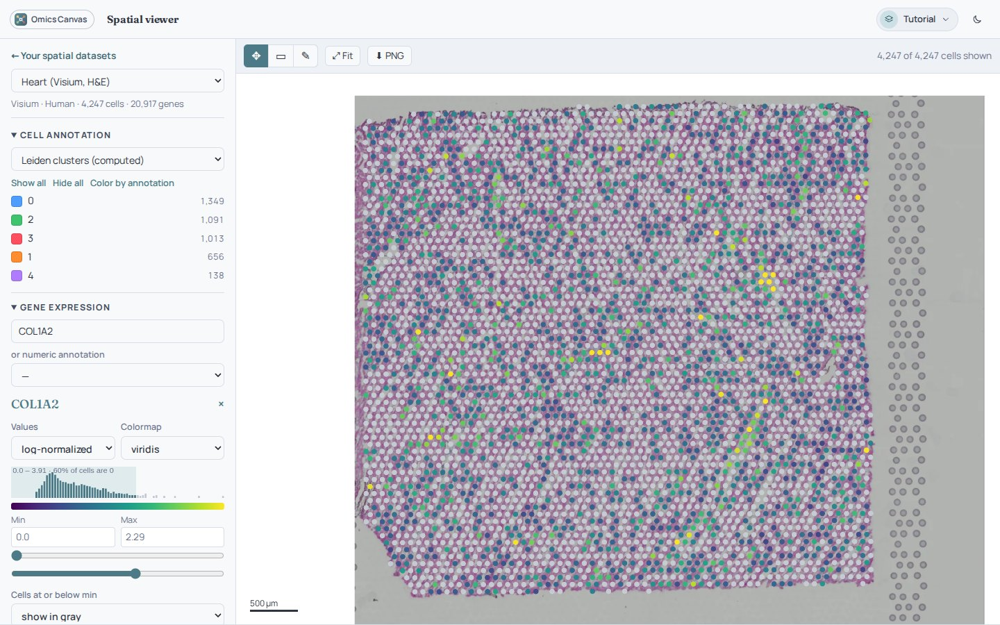

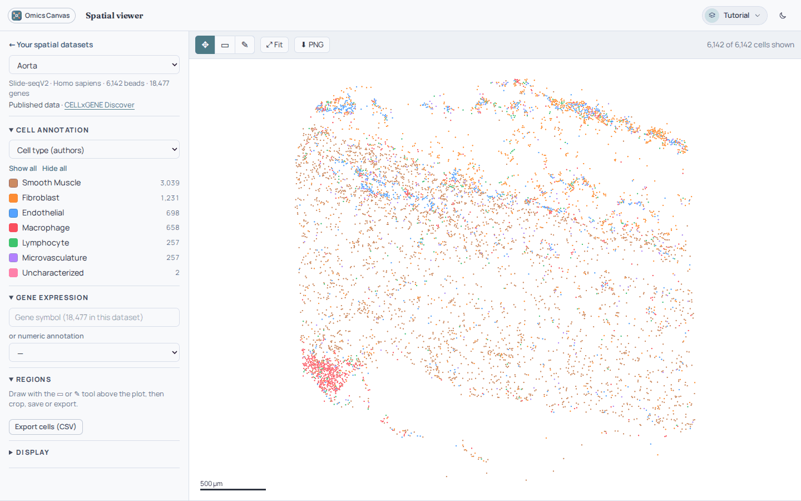

Spatial ATAC data has the same accessibility panel as the single-cell viewer below.

## 4. Single-cell viewer

`/single-cell/` — scRNA-seq, snRNA-seq, multiome and scATAC on UMAP or any embedding. The controls are those of the
spatial viewer (annotation, gene, regions, display, PNG, module scores); the layout menu switches embeddings. An
integrated UMAP is shown first when there is one (Harmony `umap_h` / `umap.harmony`, WNN, bridge integration, scVI,
CCA/RPCA …), else the first embedding.

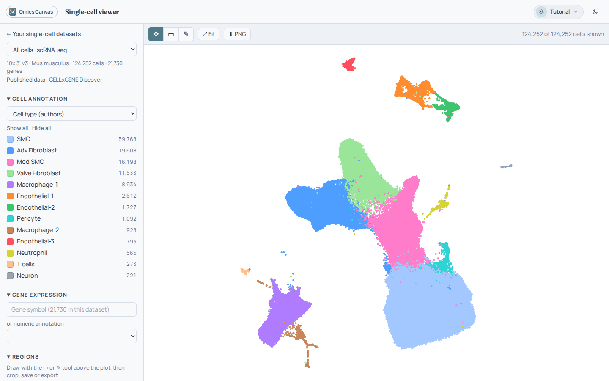

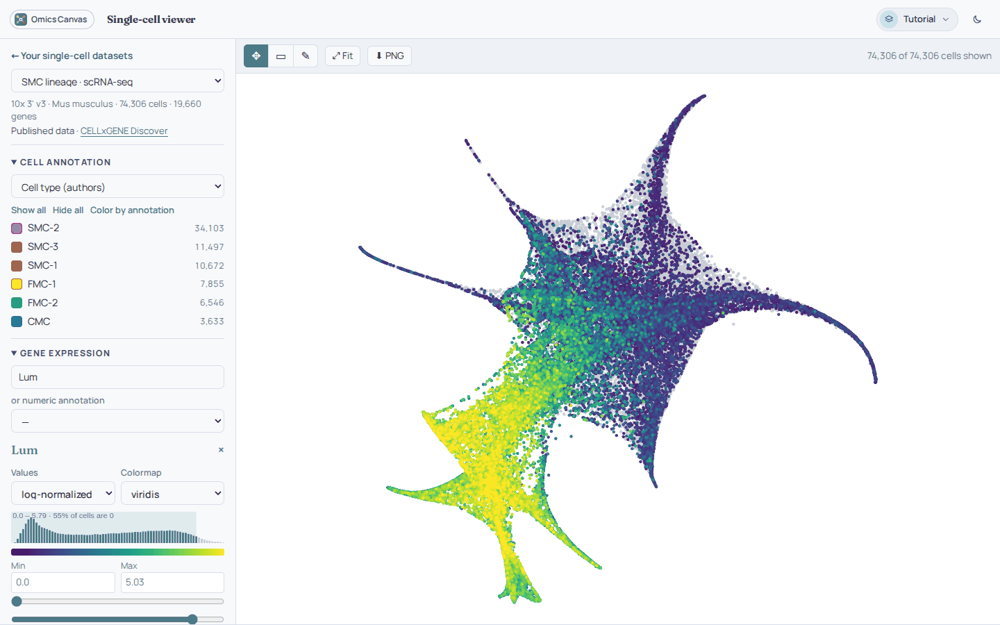

- **Samples**: a dataset can hold several samples (here scRNA-seq of the SMC lineage, of all cells, and scATAC-seq).
- **Multiome / scATAC**: choose the **Assay** — RNA, peaks, gene activity, chromVAR (diverging colors around 0; the
  motif's sequence logo is shown).
- **Chromatin accessibility** panel (with any assay that has genomic positions): coverage of each cell group around
  the gene you type, the dataset's peaks and gene models. ◀ ▶ move, ＋ － zoom, *Same scale* compares groups, the peak
  threshold filters peaks; drag over the tracks to mark a region and **Color cells by this region**.

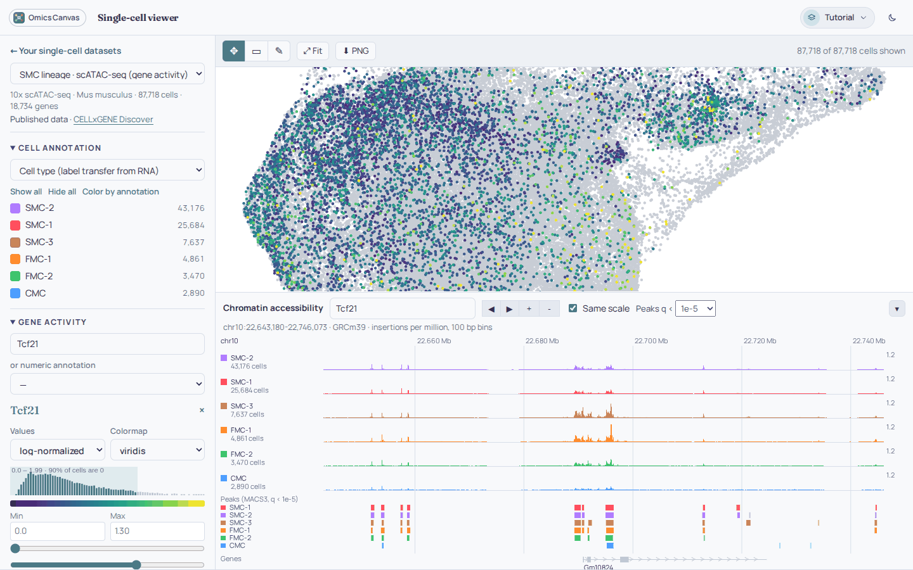

## 5. CRISPR explorer

`/crispr/` — enhancer screens (e.g. TAP-seq) and Perturb-seq, from SCEPTRE, IGVF or any target / gene / log2FC /
p-value table. The menu at the top switches screens (combined screens are listed under their name). A screen's
interactive reports open from buttons next to it, labelled by the page's own title (**Gene Program Explorer** for
PerturbNMF): one next to the screen's results (`…/perturbnmf/gene_program_explorer/report/`) is found on its own. The
screen's owner links others or removes them with the folder button there (**Link Gene Program Explorer…** when there
is none) or **Reports…** on the CRISPR datasets page: browse to the HTML file, select it, **Add selected file**. Volcano plots: up-regulated red, down-regulated blue.

**Enhancer screens** — every enhancer–gene test:

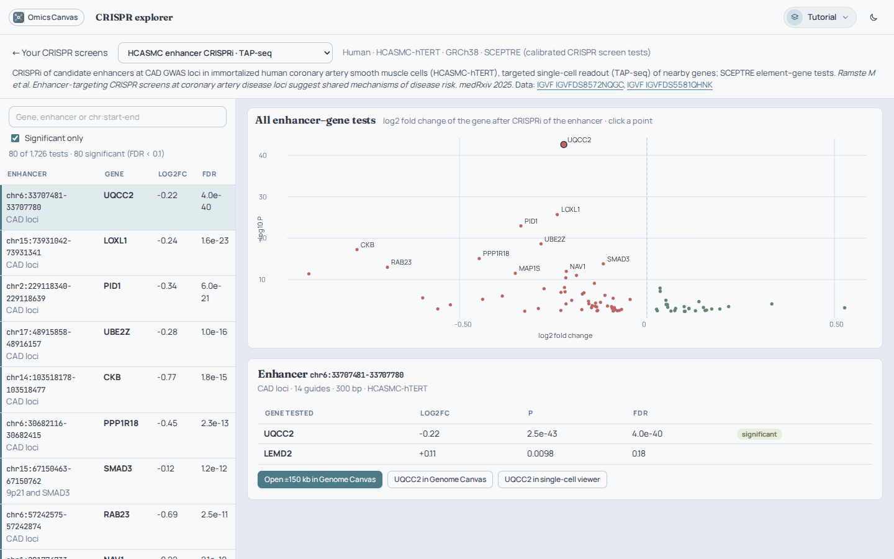

- Search a gene, an enhancer or `chr:start-end`; **Significant only** keeps tests at FDR < 0.1. **Export table (CSV)**
  under the search saves every test shown (all columns: element, position, gene, log2FC, P, FDR, guides), and
  **Download (CSV)** in the enhancer's panel saves its tested genes.
- Click a point or a row: the enhancer's tested genes with log2FC, P and FDR.
- **Open ±150 kb in Genome Canvas** shows the region with the enhancer highlighted and two loop tracks — the screen's
  significant and all tested enhancer → gene links (arc height = |log2FC|); the gene buttons open the gene in Genome
  Canvas (with the loops) or in the single-cell viewer.

**Perturb-seq** — targets ranked by the number of genes they change, and one target's effect on every readout gene:

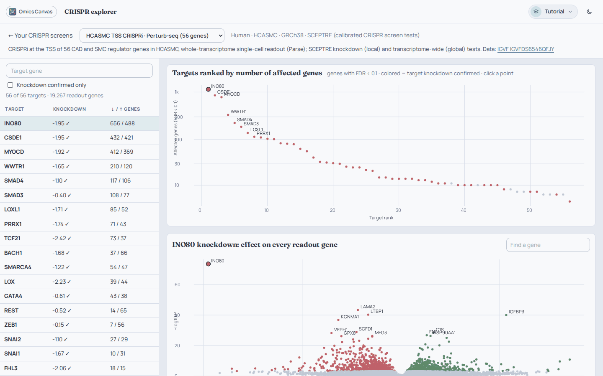

- Click a target (plot or table); **Knockdown confirmed only** keeps targets whose own expression dropped.
- **Find a gene** shows which perturbations change that gene. CSV downloads: **Export table (CSV)** (the targets
  shown, with knockdown and affected-gene counts), **Download all … results (CSV)** under a target (its effect on every
  readout gene) and under a gene (every perturbation's effect on it).

## 6. Shared data

Everything anyone in the lab has loaded is listed for everyone, so you can open what a colleague already converted or
found without asking for its path. There is one list per module: **Shared tracks** in Genome Canvas, and **Shared
datasets** (**Shared screens** in the CRISPR explorer) in the other three. Nothing is copied: you add the same files
to your own list.

**Shared datasets** — in the spatial and single-cell viewers the card under the dataset picker, in the CRISPR explorer
the button next to the screen picker, and on each dataset page the button next to *Datasets*. The number on it is how
many shared datasets you do not have yet.

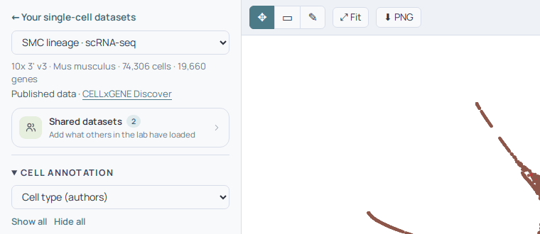

It lists every dataset anyone has loaded, converted or combined in this viewer: name and source folder, contents
(cells, samples, screen type), who shared it (+ how many others use it) and when it last changed. A combined dataset
is one row with the data it combines inside it, as on the dataset pages: the arrow next to its name opens it, and each
of them can also be added on its own.

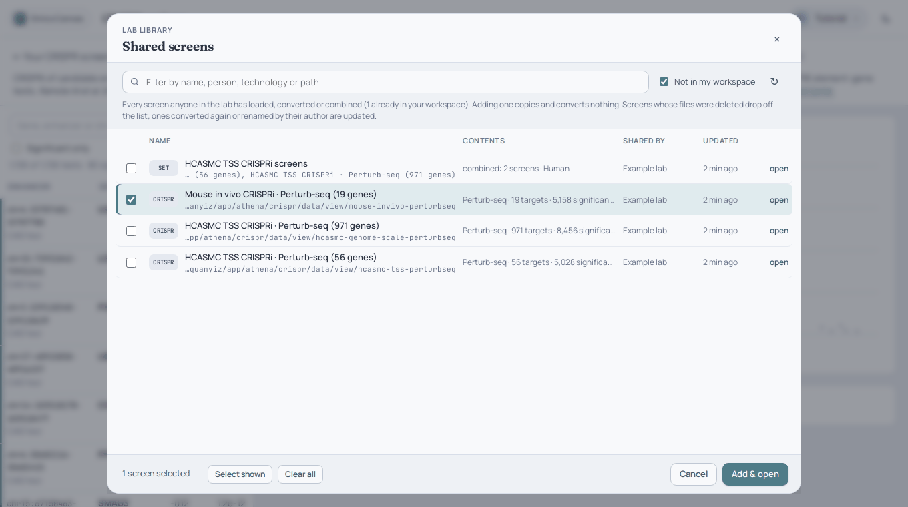

- Tick one or more and **Add selected** — in a viewer **Add & open**, which opens the first one. They join your
  workspace at once: nothing is copied, nothing is converted again. *open* at the end of a row looks at a dataset
  first, through its owner's link.
- **Not in my workspace** (on by default, like *Only hg38* in Genome Canvas) leaves out what you already have. Switch
  it off to see those too: they are greyed out and marked *in yours*.
- Filter by name, person, technology or path; **Select shown** / **Clear all** work on what is shown.
- **Shared by you** (at the bottom) lists what you added first; **Unshare** takes one off the list for the others
  (your own dataset stays, and it is shared again if you add it again).

**Shared tracks** (Genome Canvas) — the card under **Open server files** lists every file loaded from the shared server
folders, with its folder, format, genome and who loaded it. Tick and **Load selected tracks**. **Only hg38** (the
genome in view) and **Not in this view** (the tracks you have open) are on by default. Files in Home folders are never
listed; **×** on a file you shared first takes it off the list. Files marked *saved view* came from share links made
before the list existed and belong to no one: anyone can take them off.

**Tracksets** are listed there too: a named group of files, loaded together as separate tracks or as one **layered**
track (signal files overlaid in their colors, like UCSC's *Layered H3K27Ac*; the lab has **Layered H3K27ac (ENCODE)**,
7 cell lines on hg38). The arrow shows a set's files (each can be loaded alone); its files are not listed again on
their own. Make one from ticked files (**Make trackset…**) or from the server tracks in view (the stack button above
the track list): name, *One layered track* or *Separate tracks*, each layer's color. **Edit** on your own set
renames it, reorders, recolors or removes its files, adds files (search the shared tracks by name or folder, or **Add
tracks in view**), or deletes it.

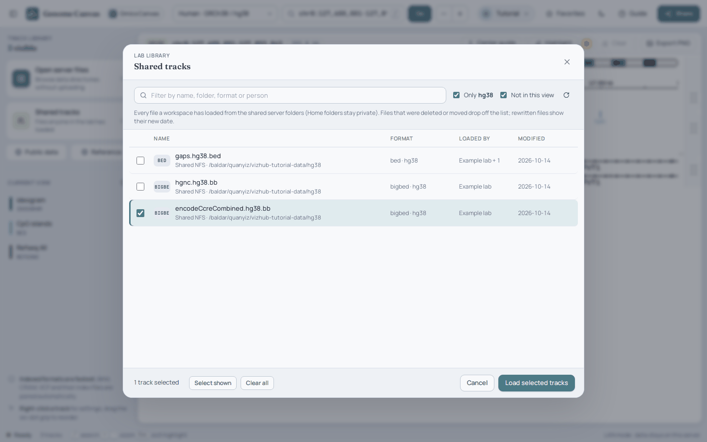

**The lists follow the files.** They are checked whenever they are opened and every hour:

- a dataset whose converted files were deleted, or a track whose file was deleted or moved, disappears;
- a dataset converted again, or renamed or given new samples by the person who added it, shows the new version;
  a rewritten track shows its new date;
- a conversion whose source file changed afterwards is marked *source changed* (select the source under **Add data** to
  convert it again), one whose source was deleted *source removed* (it still opens).

## 7. Adding and managing data

Each viewer's page without a dataset (`/spatial/`, `/single-cell/`, `/crispr/`) manages its datasets. **Shared
datasets** next to *Datasets* opens the lab's list ([section 6](#6-shared-data)).

**Add data** — browse `/nfs` (or paste a path) and select a file or folder; the right side says what it is and how
it will be read.

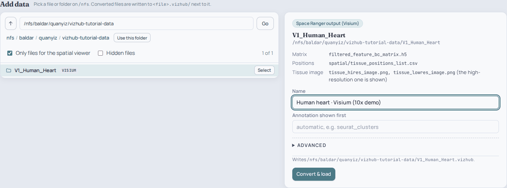

| Viewer | Reads |
| --- | --- |
| Spatial | `.h5ad` with `obsm["spatial"]` (H&E from `uns["spatial"]`); Seurat / SpatialExperiment `.rds` (Visium, Visium HD, Xenium / FOV, spatial ATAC) with their images; Space Ranger folders (`spatial/` + matrix); Xenium output folders (morphology, cell outlines, post-Xenium H&E with its Xenium Explorer alignment) |
| Single-cell | `.h5ad`; Seurat / Signac / SingleCellExperiment `.rds` (every assay, chromVAR motifs, fragment files → accessibility tracks); `.h5mu` MuData; 10x `.h5`; `.loom` |
| CRISPR | SCEPTRE / IGVF / generic result tables (`.tsv`, `.csv`, `.parquet`) or an `.rds` sceptre_object / data.frame |
| All | folders already in the viewer format (`slide.json`, `project.json`) are loaded as they are |

- **Convert & load** writes the viewer files to `<source>.vizhub/` next to the source (sources are never changed).
  **Advanced** sets the matrix, assay, µm per pixel, spot size, a computed UMAP (with Leiden clusters), the GTF and
  whether to read fragment files.
- **Conversions** run on THOR — close the page or your laptop, they continue. At most 8 run at once (the rest wait in
  line); after a restart they resume from their last finished step, and long ones (large fragment files) say how long
  to expect. **Show log** shows the converter's output.

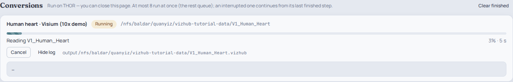

**Combine datasets** — put samples of several datasets (sections, time points, conditions; CRISPR: screens) into one
dataset with one link and a sample picker. Order and rename the samples; nothing is copied.

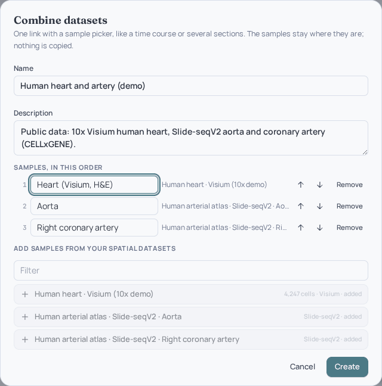

The list shows combined datasets and multi-sample projects as groups: the arrow opens their samples, and the datasets
that went into a combined one are listed there (with their own **Rename** / **Remove**).

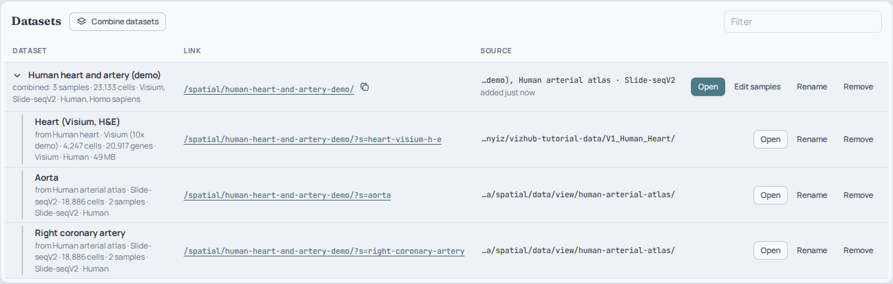

- **Edit samples** changes a combined dataset later — and the samples of existing projects (e.g. drop or rename a
  section); a project folder itself is not changed, **Restore the folder's samples** undoes it.
- **Rename** changes the name (not the link). **Remove** takes a dataset out of your workspace; for converted data
  you may also delete the `.vizhub` folder (kept while a combined dataset or another workspace uses it). Source data is
  never deleted.

## 8. Mac apps

Download from the [latest release](https://github.com/QuertermousLab/omics-canvas/releases/latest) — Apple Silicon
(`…-macOS-arm64.zip`) or Intel (`…-macOS-x86_64.zip`), unzip, move to Applications and run once in Terminal
(the apps are not notarized):

```bash
xattr -dr com.apple.quarantine "/Applications/Omics Canvas.app" "/Applications/Genome Canvas.app"
```

Both apps show the server's sign-in page in their window the first time; with **Keep me signed in** they stay signed
in for a year. Genome Canvas.app's This Mac mode needs no sign-in.

**Genome Canvas.app** — the genome browser in a native window: the same canvas with a native track list, genome and
locus fields, highlight tools and workspace menu. **Server** uses THOR's files; **This Mac** starts a built-in backend
for files on your Mac (**Open local files**). The **Shared tracks** card (Server only) opens the lab's shared track
list. Shortcuts: ⌘O server files, ⌘D public data, ⇧⌘L shared tracks, ⇧⌘S favorites, ⇧⌘E PNG,
⇧⌘T light / dark, ⌘, server and port forwarding.

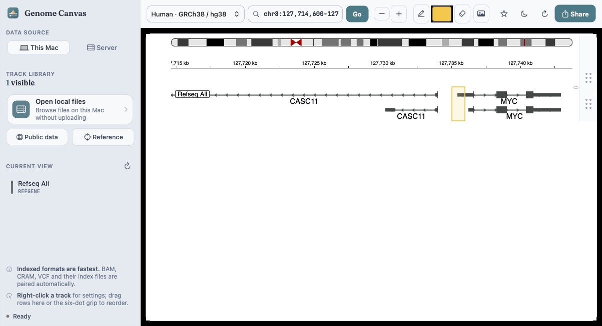

**Omics Canvas.app** — the spatial, single-cell and CRISPR viewers in one window. The sidebar picks the viewer
(⌘1 / ⌘2 / ⌘3), your workspace and your datasets: groups (combined datasets, projects) open with the arrow, a sample
opens with a click. Right-click a dataset for **Open**, **Edit Samples…**, **Rename…**, **Remove…**,
**Combine Datasets…**; the stack button above the list combines too. **Shared datasets** (**Shared screens**) under the list
(⇧⌘L) opens the viewer's shared list to add to yours.

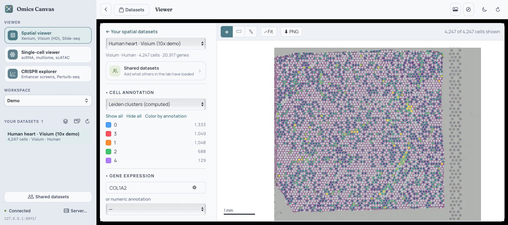

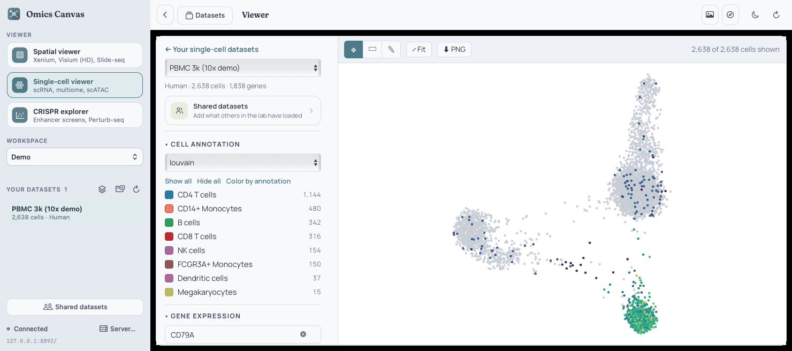

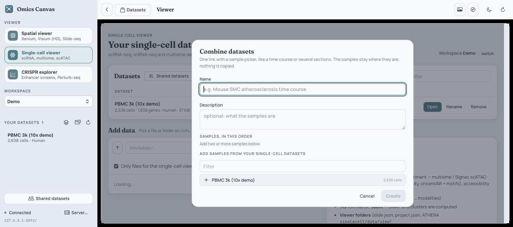

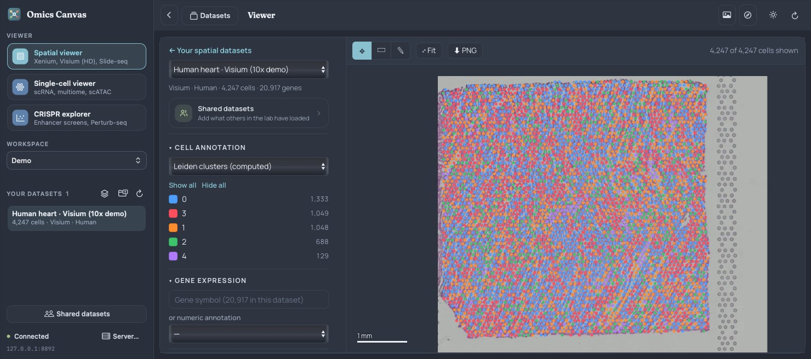

- Toolbar: back, **Datasets** (add, convert, manage — ⌘O), Export PNG (⇧⌘E), open the page in your browser (⇧⌘B),
  light / dark (⇧⌘T), reload (⌘R).
- Genome Canvas links (from the CRISPR explorer) open in **Genome Canvas.app** when it is installed — in place if it
  is already open, keeping its tracks — otherwise in your browser.

**Server and port forwarding** — both apps connect to THOR (171.65.68.140, port 8892) by default. **Server…** in
Omics Canvas's sidebar, **Connect to Server…** / the **Server** button in Genome Canvas (⌘, in both) change it:

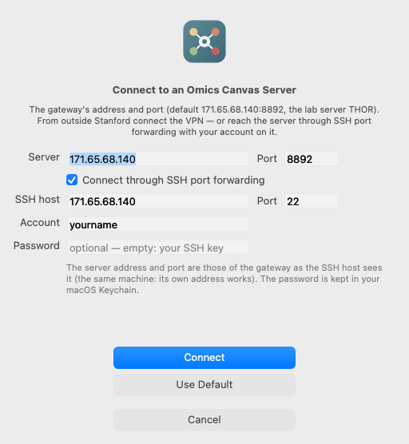

1. **Server** and **Port**: the Omics Canvas gateway. For another lab server use the address and port its
   administrator gives you (`./vizhubctl status` on the server prints them).
2. Off campus without the VPN, or for a server that only listens on its own machine: tick **Connect through SSH port
   forwarding**, then **SSH host** (empty: the server itself) and its **Port** (usually 22), your **Account** on it and,
   optionally, your **Password**. The password is kept in the macOS Keychain; leave it empty to log in with your SSH
   key. The first time, macOS may ask whether the app may use its Keychain item — choose **Always Allow**.
3. **Connect**. The app opens the tunnel itself (like the `ssh -L` command in [section 1](#1-getting-started)), keeps
   it while it runs and reconnects after sleep or a network change. The sidebar shows the connection, e.g.
   `171.65.68.140:8892 · SSH yourname@171.65.68.140`; **Use Default** goes back to THOR without a tunnel.

## 9. Tips

- **Share** any view by copying the address: dataset, sample (`?s=`), gene (`?gene=`) and CRISPR selection are in it.
- **Figures**: every PNG export has a transparent background; set the plot background under *Display* to preview it.
- **No login**: anyone who can reach port 8892 can open dataset links, and every dataset you add (and every server file
  you load in Genome Canvas outside your Home folder) is listed under Shared for the whole lab; workspaces keep lists
  tidy, they are not access control. Do not add data that must stay private.
- **Large data**: 50–100 GB fragment files take hours; the conversion card shows an estimate. Uncheck the fragment files
  under *Advanced* for a quick first look.
- **API**: scripts can read a spatial or single-cell dataset's expression without the viewer. `<id>` is the dataset's
  name in its link (`/single-cell/<id>/`); add `sample=` for a dataset with several samples.
  - `GET /hub/api/datasets/<id>/expression` lists its samples, assays (with or without counts) and annotations.
  - `GET` or `POST /hub/api/datasets/<id>/matrix` returns a file, for example:
    `curl -o smc.csv 'http://171.65.68.140:8892/hub/api/datasets/<id>/matrix?genes=MYH11,ACTA2&obs=cell_type&values=SMC&values=Fibroblast&value=counts'`.
    It takes:
    - `genes` (comma-separated; none means every gene);
    - cells by any of `cells` (cell ids), `indices` (0-based row numbers), `obs` with `values` (an annotation and
      its categories), or `where` (JSON, `{"cluster": ["SMC"], "nCount_RNA": {"min": 500}}`);
    - `value` (`normalized` or `counts`);
    - `format` (`csv`, `tsv`, `csv.gz`, `tsv.gz`, `mtx`);
    - `orient` (`cells` or `genes` as rows);
    - `meta` (annotation columns to add).

    Without cell criteria you get every cell.
  - `GET` or `POST /hub/api/datasets/<id>/distribution` returns one `gene`, saved `module` (its id) or `metric`
    per `group` as JSON: densities, quartiles and sampled points, the data behind the plots.

  In R, `read.csv(url)` reads a CSV link directly.
- **Problems**: a conversion card's **Show log** has the converter's message; the dataset page of each viewer lists
  what it reads. The project's [README](../README.md) covers the server and command-line conversion.
