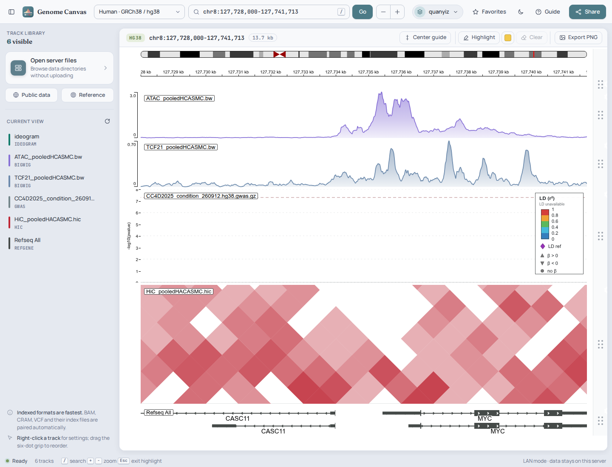
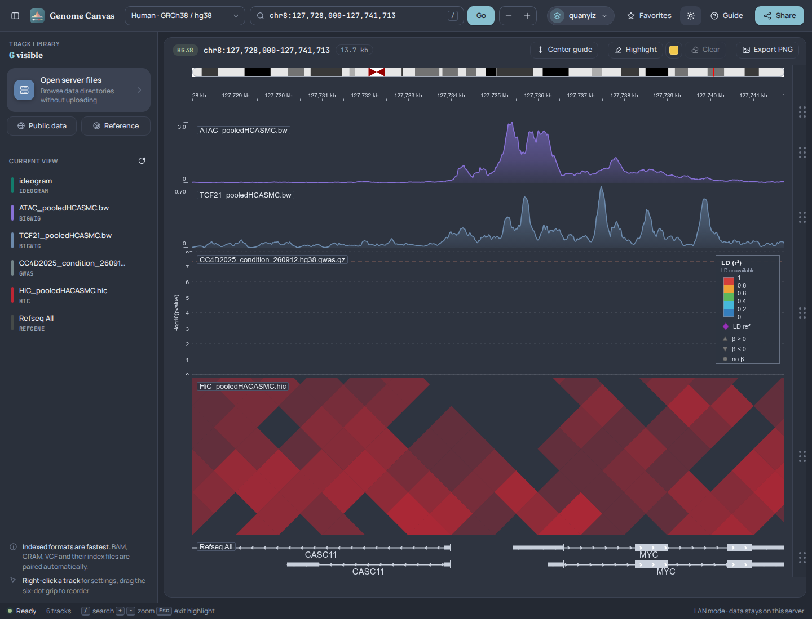
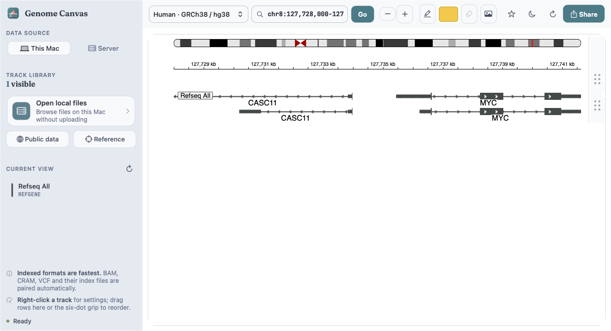
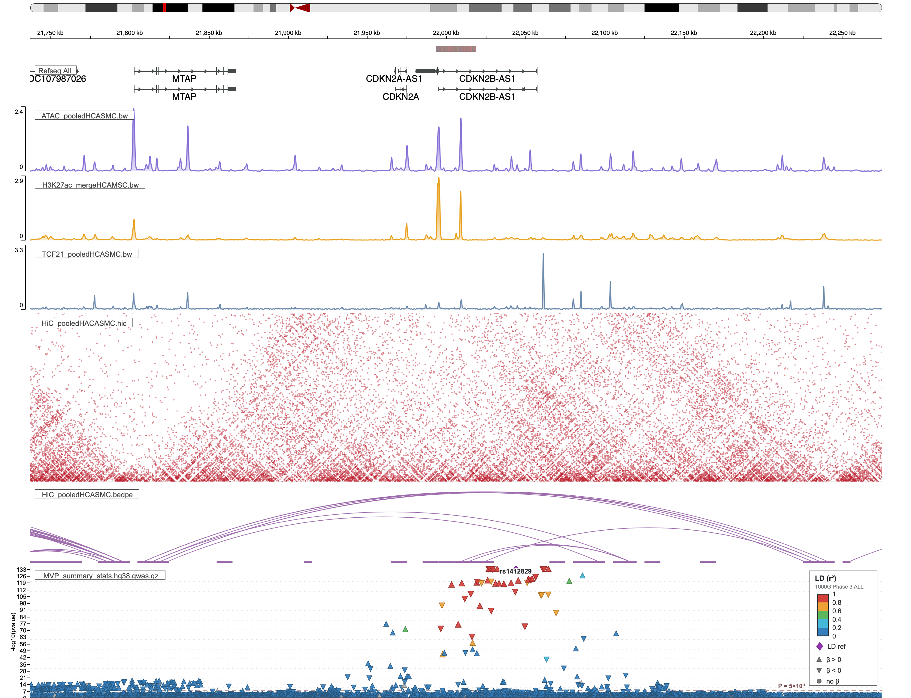

# Genome Canvas

Genome Canvas is a local-network genome browser for laboratories and research teams. It uses [IGV.js 3.8.5](https://github.com/igvteam/igv.js) as its browsing engine and provides secure server-directory browsing with HTTP Range support, so large BAM, CRAM, VCF, and Hi-C files can be viewed without uploading or copying them.

[Migration guide](docs/MIGRATION.md) · [Security](SECURITY.md)

## Features

- Common reference genomes including hg38, hg19, mm39, mm10, rn7, danRer11, dm6, and sacCer3
- Custom FASTA + FAI and 2bit reference genomes
- Direct access to configured server directories without file uploads
- Shared tracks: every file a workspace has loaded from a shared data root (not Home folders), listed for the whole lab; deleted or moved files drop off the list and rewritten ones show their new date
- Tracksets: named groups of shared files, listed for the lab under Shared tracks and loaded together, as separate tracks or overlaid in one layered track (like UCSC's Layered H3K27Ac); the lab server has the ENCODE Layered H3K27ac set (7 cell lines, hg38)
- Favorites can be shared with the lab: others open them or save a copy
- Genome build check: a loaded file whose header (chromosome sizes of bigWig, bigBed, BAM, VCF, .hic) or name says it is on another build than the view is offered a liftover; the check reads a few kilobytes (about 5 ms)
- Liftover between builds with UCSC chain files: pasted regions or the view (liftOver), and track files — BED/narrowPeak, bedGraph/WIG/bigWig, BAM/CRAM, GFF/GTF, VCF, BEDPE — with CrossMap; converted files are written under the Genome Canvas data folder, never next to the source
- LocusCompare (as [locuscompare.com](http://locuscompare.com), Liu et al. 2019): a GWAS track in view against the GTEx eQTLs of one gene — the two studies' −log10 p against each other and a LocusZoom panel for each, colored by LD with the lead SNP (1000 Genomes population, or the study's own LD); from a GWAS track's menu, a SNP's popup or the LocusCompare button; SVG, PNG and table downloads
- Automatic discovery of `.bai`, `.crai`, `.tbi`, `.csi`, and `.fai` indexes
- Major formats including BAM, CRAM, VCF, BCF, BigWig, BigBed, BED, BEDGraph, WIG, GFF/GFF3, GTF, Hi-C contact heatmaps, BEDPE, SEG, MAF, GWAS, and QTL
- LocusZoom-style regional association plots for indexed GWAS summary statistics, with p-value guides, lead-variant labels, and complete variant tooltips
- Searchable public track-hub catalog with UCSC `hub.txt` and WashU JSON data-hub support
- Selective loading from ENCODE, GTEx, Roadmap Epigenomics, and 4DN hubs, plus custom hub URLs
- Automatic assay color families with deterministic sample-specific shades
- Wide UCSC/WashU-style track reorder grips with full-height drag targets
- PNG export of the current canvas
- LAN share links stored on this server
- Responsive layout, keyboard search (`/` or `Ctrl/⌘ K`), and zoom controls
- Nord light ("Snow Storm") and dark ("Polar Night") interface themes that follow the operating system, with a manual toggle in the top bar

## Screenshots

### Web browser





### Native macOS app



### Exported PNG



## Quick start

Requirements: Python 3.8 or newer. IGV.js is vendored, so the application does
not need npm or internet access at runtime.

```bash
git clone https://github.com/QuertermousLab/omics-canvas.git
cd omics-canvas/genome-canvas
cd genome-canvas
cp genomecanvas.config.example.json genomecanvas.config.json
./start.sh --host 0.0.0.0 --port 8000
```

Open `http://127.0.0.1:8000` locally. Other devices on the same LAN can use:

```text
http://SERVER_IP:8000
```

The deployed file browser exposes the signed-in user's home directory, the shared `/nfs` namespace, and the project's `data` directory. Paths entered in the `SERVER PATH` field remain beneath the selected root; direct traversal outside it is rejected. Existing symbolic links located beneath an exposed root may point to shared storage elsewhere on the server, and linked track indexes are served through the same controlled namespace.

### Access Through the 8892 Gateway

The current deployment runs behind a user-level Apache gateway and reuses the already permitted `8892` port:

```text
http://SERVER_IP:8892/genome-canvas/
```

JupyterLab remains at `/lab` with its existing login. Genome Canvas uses a password-free workspace selector. Both backends listen only on `127.0.0.1` and are exposed through the gateway.

### Native macOS App

`macos/GenomeCanvasDesktop` contains a native AppKit desktop workbench for
macOS 13 or later. AppKit owns the toolbar, workspace and track sidebar,
drag-to-reorder list, navigation, highlights, sharing, export and connection
status. WebKit is used only for the IGV genome canvas and server-backed dialogs.
The native window uses the same Nord light/dark themes, fonts and sidebar layout
as the web interface; it follows the macOS appearance, with a manual choice in
the toolbar and **View → Appearance**.

The desktop app has two data-source modes:

- **This Mac** starts the backend bundled inside the app on a random loopback
  port. **Open Local Files** browses files readable by the current macOS user;
  no `/nfs` mount, upload, server installation, or workspace switching is
  required. Local Favorites are stored under `~/Library/Application Support/Genome Canvas`.
- **Server** connects to an existing Genome Canvas LAN deployment and retains
  its per-user/per-project workspace behavior.

Download a prebuilt app for your Mac:

- [Apple Silicon (arm64)](https://github.com/QuertermousLab/omics-canvas/releases/latest/download/GenomeCanvasDesktop-macOS-arm64.zip)
- [Intel (x86_64)](https://github.com/QuertermousLab/omics-canvas/releases/latest/download/GenomeCanvasDesktop-macOS-x86_64.zip)

The release archives are ad-hoc signed rather than Apple-notarized. If
Gatekeeper requests confirmation, Control-click the app and choose **Open**.
If macOS still blocks the app after you move it to `/Applications`, remove the
download quarantine attribute and open it again:

```bash
xattr -dr com.apple.quarantine "/Applications/Genome Canvas.app"
```

Only use this command for the app downloaded from this repository.

To build from source on a Mac:

```bash
cd macos/GenomeCanvasDesktop
./build.sh
open "dist/Genome Canvas.app"
```

Every launch defaults to **Server**. Enter its IP/port once and the app remembers
it for later launches. Choose **This Mac** or **Server** in the native
sidebar, or use **Genome Canvas → Use Local Backend** and **Genome Canvas →
Connect to Server…**. Entering remote mode automatically stops the local
backend. A server address may be a LAN hostname or a reverse-proxy path such as
`http://genome-canvas.example.internal/genome-canvas/`.

Home workspaces are discovered from the immediate subdirectories of `/home`. Selecting one adds that Home as the default file root. Manual workspaces can be created in the browser and default to the shared `/nfs` root. Each workspace has independent Favorites and file-browser history. Hiding an automatically discovered Home workspace only removes it from the selector; it never deletes the directory or its files, and it can be restored from the hidden-workspace section.

The locus search accepts genomic coordinates, gene symbols, and human rsIDs. `hg38` rsIDs are verified against the configured local dbSNP 156 VCF after their assembly placement is resolved. Configure the local file with `dbSnpHg38` in `genomecanvas.config.json`.

### Run as a Persistent User Service

In the Omics Canvas repository Genome Canvas runs as the user-level systemd unit `genome-canvas.service`
behind the gateway, both generated and linked by the root `vizhubctl` (see the root README, "Deploying on another
server"):

```bash
../vizhubctl configure && ../vizhubctl install
```

On its own, `deploy/genome-canvas.service.example` is a system service and `deploy/nginx.conf.example` a reverse proxy.

Common management commands:

```bash
./genome-canvasctl start
./genome-canvasctl stop
./genome-canvasctl restart
./genome-canvasctl status
./genome-canvasctl monitor
./genome-canvasctl logs
```

`stop` only stops Genome Canvas and leaves the shared port-8892 gateway running
for JupyterLab. Use `gateway-stop` only when both sites may be interrupted. Run
`./genome-canvasctl help` for autostart, Apache access-log, and monitor options.

### Running Temporarily on Another Server

The project directory lives on shared NFS, so another lab server can run the
same checkout while the main server is unavailable. Start only the backend,
bound to localhost (the port-8892 Apache gateway is not required):

```bash
cd ~/baldar/vizhub/genome-canvas
./start.sh --host 127.0.0.1 --port 8000
```

Then forward the port from your own computer and open `http://localhost:8892/`:

```bash
ssh -N -L 8892:127.0.0.1:8000 quanyiz@TEMPORARY_SERVER
```

Share links created this way point at `localhost`, so they only work for people
using the same tunnel. Workspaces, Favorites and share links are stored in
`.genomecanvas/` on NFS and are visible to both servers; stop the temporary
instance before the main deployment resumes so only one process writes the
workspace database. No unit files, ports or paths need to change for the main
server at `http://171.65.68.140:8892/genome-canvas/`.

## Interface

The UI is plain HTML/CSS/ES modules with no build step. Interface colors are
CSS custom properties in `styles.css`: `:root` holds the light theme and
`html[data-theme="dark"]` the dark theme. Track colors are owned by
`track-colors.mjs` and the renderer modules and are identical in both themes.
In the dark theme the track canvas is Nord `#2e3440`: `canvas-theme.mjs` swaps
only canvas chrome (ruler, axes, labels, legends, empty Hi-C cells) and draws
neutral dark-gray features such as RefSeq genes in light gray so they stay
visible; colored tracks are unchanged. Export PNG always renders with the
light palette on a transparent background, whichever theme is active. Manrope, Fraunces and JetBrains Mono (SIL
OFL 1.1, licenses alongside the files) are bundled in `vendor/fonts/`, so no
font service is contacted. `public/favicon.svg` is the application logo; the
macOS client icon `macos/GenomeCanvasDesktop/Resources/GenomeCanvas-1024.png`
is rendered from the same design.

### Opening a View From a Link

Other pages can open a view with URL parameters (shared views keep using `?session=`):

| Parameter | Example | |
| --- | --- | --- |
| `locus` | `chr8:127,600,001-127,900,000` or `MYC` | region (1-based) or a gene / rsID to search |
| `genome` | `hg38` | one of the genome menu's ids |
| `highlight` | `chr8:127,735,001-127,736,000` | repeatable; `;` separates several in one value |
| `color` | `5f8a6a` | highlight color |
| `track` | `Loops\|/hub/api/arcs/screen/significant.bedpe` | repeatable `name\|url` (http(s) or a server path); BEDPE draws proportional arcs |

The macOS app registers `genomecanvas://open?<same parameters>`: the link opens in the app on its current server
(or local backend), in place when a canvas is already open, so loaded tracks stay.

## Configure Server Data Directories

Copy the example configuration and edit its paths:

```bash
cp genomecanvas.config.example.json genomecanvas.config.json
```

`dataRoots` accepts multiple directories. The web application exposes only supported files within those roots. Directories can also be supplied temporarily through an environment variable; separate multiple Linux or macOS paths with colons:

```bash
GENOME_DATA_ROOTS=/data/project-a:/mnt/sequencing ./start.sh
```

Optional environment variables:

- `GENOME_CANVAS_HOST`: listening address; default `0.0.0.0`
- `GENOME_CANVAS_PORT`: listening port; default `8000`
- `GENOME_DATA_ROOTS`: permitted data roots
- `GENOME_CANVAS_REFERENCE_DIR`: local reference cache; default `.genomecanvas/references`

### Liftover

Liftover runs the UCSC `liftOver` and `CrossMap` programs (found on `PATH`, `/usr/local/bin` or `~/.local/bin`; VCFs
also use `bcftools` and `tabix`, BAMs `samtools`). Chain files are read from `data/liftover/chains`, named like UCSC's
(`hg19ToHg38.over.chain.gz`); each one there adds a pair of builds. Converted files go to `data/liftover/<build>/`, and
the folder must be inside a data root so they can be served. Optional settings in `genomecanvas.config.json`:

- `liftoverFasta`: the target build's FASTA for VCF liftover, e.g. `{"hg38": "/refs/hg38.fa"}`
- `liftoverChainDir`, `liftoverDir`: other folders for the chain files and the converted files
- `liftoverChains`: extra chain files, `{"hg19:hg38": "/refs/hg19ToHg38.over.chain.gz"}`

### LocusCompare

`/api/locuscompare` (`locuscompare.py`, standard library; `tabix` and `plink2` are external programs) reads the GWAS
track's file and one tissue's eQTLs in the region, matches variants by hg38 position and alleles (either strand, else
rsid), and picks LocusCompare's lead SNP (smallest sum of the two p-values) unless one is given. LD is the r² with the
lead in a 1000 Genomes phase 3 population (the `ldReferenceHg19` panel, by rsid; populations from its `panel` file,
`integrated_call_samples_v3.20130502.ALL.panel`), or the study's own LD when its file has it (`R2` + `SIGNAL`, or
`ld_r2` + `ld_reference`). A GWAS file with a `GROUP` (or `LD_POP`) column is shown one group at a time.

eQTL data, set in `genomecanvas.config.json` under `locusCompare.eqtl` (each source's optional `tissues` lists the
ones offered; `"offerDownloaded": true` also offers every tissue downloaded since):

- GTEx v8, every tested variant–gene pair, from the eQTL Catalogue (hg38). GTEx's own all-pairs files are only on
  requester-pays Google Cloud storage; the eQTL Catalogue serves the same data over FTP:
  `python3 tools/fetch_gtex_eqtl.py --out data/eQTL/GTEx_v8 --tissues artery_coronary artery_aorta artery_tibial`
  (~3.5 GB per tissue; `--list` shows the 49). With `"remote": true`, tissues not downloaded are read from EBI with
  tabix, one query at a time.
- GTEx parquet releases (v10 / v11 significant pairs only, so the plot shows only variants below each gene's
  threshold): `hub/venv/bin/python tools/gtex_parquet_to_eqtl.py <GTEx_Analysis_v11_eQTL> data/eQTL/GTEx_v11_signif`.

Genes come from a GENCODE table (`locusCompare.genes`, default `data/eQTL/genes.gencode_v39.hg38.tsv`: gene_id,
symbol, chrom, start, end, strand, type; v39 is the annotation of the eQTL Catalogue's GTEx). GWAS Catalog harmonised
files become GWAS tracks with `tools/gwas_catalog_to_track.py` (with `hg19_locus`, so the track also gets LD).

### Faster Reference Loading

Prepare the common assemblies once on the server:

```bash
export GENOME_CANVAS_REFERENCE_DIR="$HOME/.cache/genome-canvas/references"
python3 tools/cache_genomes.py --genomes hg38 hg19 mm10 mm39 --workers 8
./start.sh
```

Python 3.8+, `bgzip`, `tabix`, and `sort` are required for cache preparation. Downloads
run concurrently; completed downloads are reused on later runs. The four reference packs use about 3 GB;
the manifest is published only after all requested resources and indexes are ready.
The included user service uses the same cache path in the deployment user's Home.

Cached assemblies load reference sequences, chromosome sizes, aliases, cytobands,
and annotations from this server. RefGene files preserve the upstream annotation
records but are sorted, BGZF-compressed, and Tabix-indexed, so regional views load
only overlapping genes. Existing Favorites and shared views also use the cached
reference resources. Uncached genomes and arbitrary public tracks retain their
original URLs; this cache is not a general URL proxy.

Small reference files and compressed frontend assets use a bounded 256 MB memory
cache. Larger sequence files use local storage and the operating system's page
cache. Versioned frontend assets have browser caching; unversioned assets use
ETags. JSON responses and whole-file plain-text tracks (for example BED or
BEDPE without an index) are gzip encoded when the browser accepts it, and the
compressed copy is cached in memory; byte-range requests are never re-encoded.
Directory listings use `scandir` so large NFS folders only stat folders and
track files. PNG export embeds the Hi-C heatmap as a single raster image
instead of one SVG shape per contact, which makes exporting dense views about
five times faster with identical output. The page preloads IGV.js, its ES modules and the bundled fonts in
parallel, and requests the workspace configuration alongside the catalog. Workspace catalog reads are cached for ten seconds, with immediate
invalidation after application-managed workspace changes. Gene/rsID search,
BLAT, and loading new public hubs can still require public services.

## Docker Deployment

Edit the read-only volume in `docker-compose.yml` so `/data` points to the track directory, then run:

```bash
docker compose up -d --build
```

`.genomecanvas/sessions` stores shared views. Docker Compose persists it in the project directory by default.

## Index File Naming

Use these common naming conventions for automatic pairing:

| Data file | Automatically detected index |
| --- | --- |
| `sample.bam` | `sample.bam.bai` or `sample.bai` |
| `sample.cram` | `sample.cram.crai` or `sample.crai` |
| `sample.vcf.gz` | `sample.vcf.gz.tbi` or `.csi` |
| `sample.bed.gz` / GFF / GTF | matching `.tbi` or `.csi` |
| `study.gwas.gz` | `study.gwas.gz.tbi` or `.csi` |
| `genome.fa` | `genome.fa.fai` |

BigWig, BigBed, TDF, and `.hic` files are internally indexed. Hi-C contacts are rendered as a triangular, log-scaled heatmap at a resolution chosen for the current locus. Unindexed text tracks can also be loaded, but the first read of a large file may be significantly slower.

GWAS files are assumed to already match the selected reference assembly. Large
summary-statistics files should be coordinate-sorted, BGZF-compressed, and
Tabix-indexed; see `data/README.md` for the expected columns and commands. GWAS
tracks always mark the genome-wide threshold at `P = 5e-8`. When
`ldReferenceHg19` is configured and the input retains an `hg19_locus` column,
Genome Canvas calculates local unphased LD r² from the configured PLINK panel,
colors points by LD, and uses point shape to show beta direction.
For faster repeat viewing with a fixed lead SNP, `tools/precompute_gwas_ld.py`
writes a new indexed regional file with embedded r², lead and population
annotations. Embedded LD is read directly, without running PLINK. See
`data/README.md` for preparation commands and the fixed-reference limitations.
`tools/precompute_gwas_ld_genomewide.py` additionally discovers reference-panel
LD-clumped leads across the full input, computes lead-oriented LD windows,
and writes a complete annotated table, lead/locus catalogs, and an indexed
pair table. It preserves all original GWAS rows, including regions without LD.

## Public Hubs and URL Requirements

Open **Public Data** and choose **Public Track Hubs** to browse catalog entries compatible with the current assembly. Select a hub, filter its track index by sample, assay, or format, and load only the selected tracks. The custom hub field accepts a UCSC `hub.txt` URL or a WashU-style JSON data-hub URL. The **Single Track URL** tab remains available for direct BigWig, BAM, CRAM, VCF, Hi-C, and other supported files.

Remote descriptors and track files must allow cross-origin browser access with CORS. Large indexed files must also support HTTP Range requests. Genome Canvas does not proxy external URLs, and authorization tokens are not written to this server.

## Security Boundary

This is a LAN tool, not a multi-user account system. The backend only serves files within `dataRoots` and blocks path traversal. Any authenticated web user can read supported tracks visible in those roots, and every file a workspace loads from a shared root (not from a Home folder) is listed for all workspaces under Shared tracks. Do not expose the service directly to the public internet; use a VPN, reverse-proxy authentication, or firewall controls in sensitive environments.

## Verification

```bash
npm test
```

The tests use Python's standard library and Node.js built-in test runner and do not require internet access. CI runs them on every push. Native macOS interface changes can be previewed on a GitHub-hosted Mac by pushing a `mac-ui-*` branch, and pushing a `v*` tag publishes the macOS release; see the [macOS client README](macos/GenomeCanvasDesktop/README.md). IGV.js is distributed under the MIT License; its license is stored at `vendor/IGV-LICENSE.txt`. See the [official IGV.js documentation](https://igv.org/doc/igvjs/) for additional browser options and format details.
